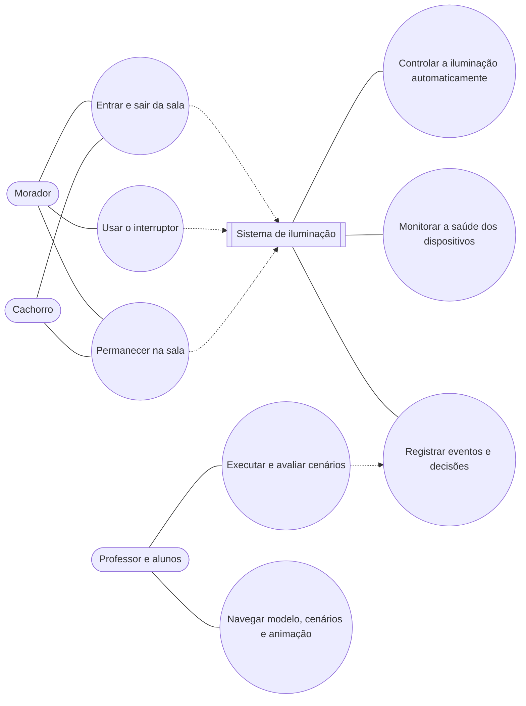
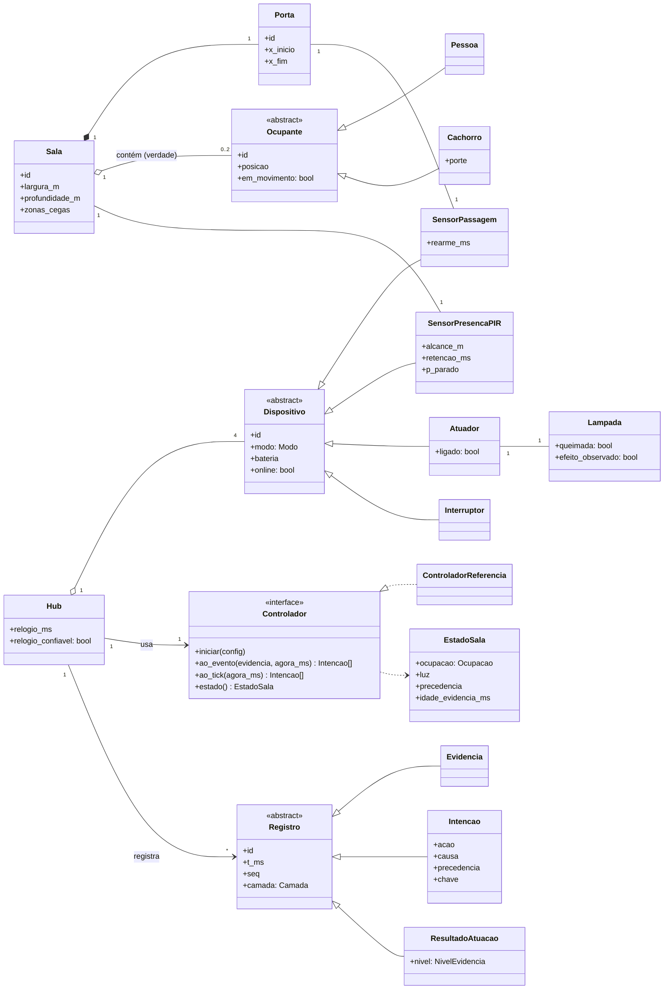
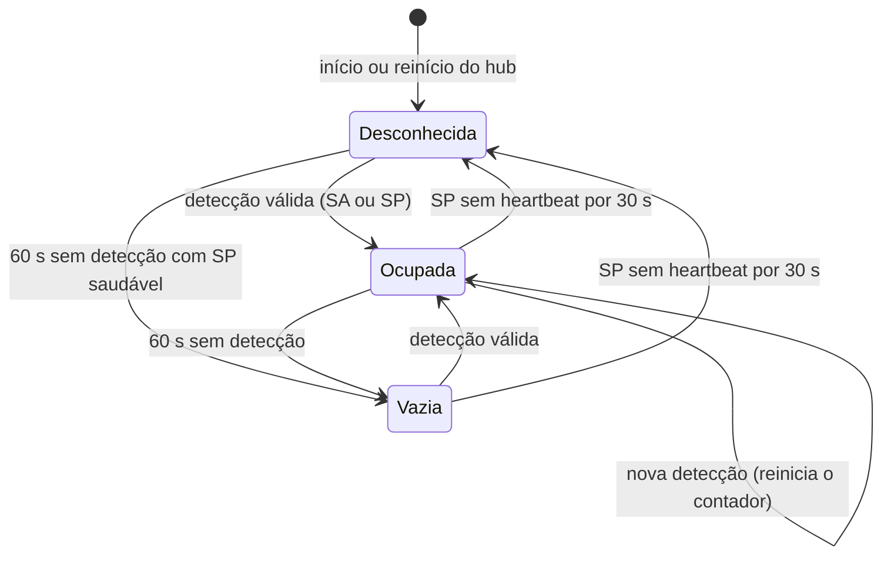
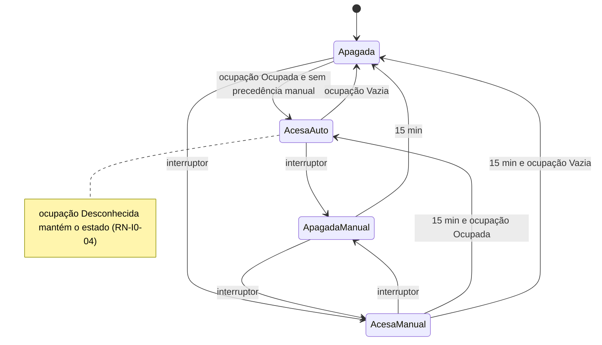
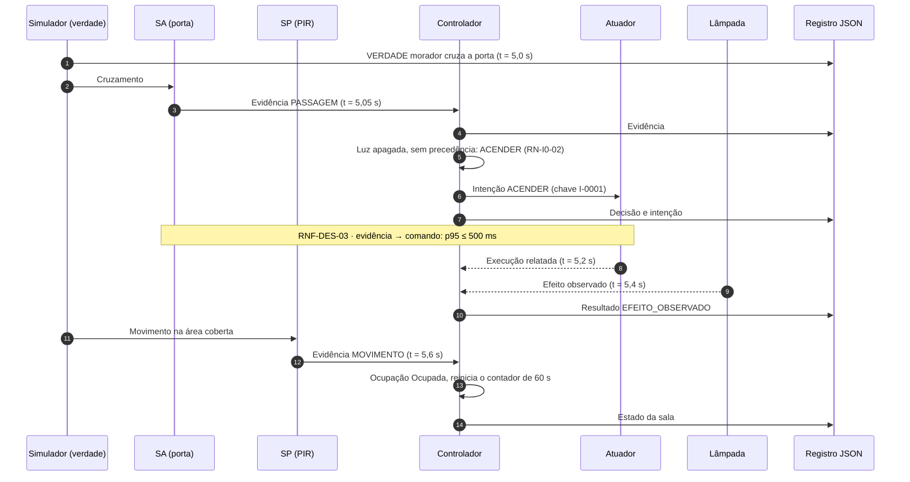
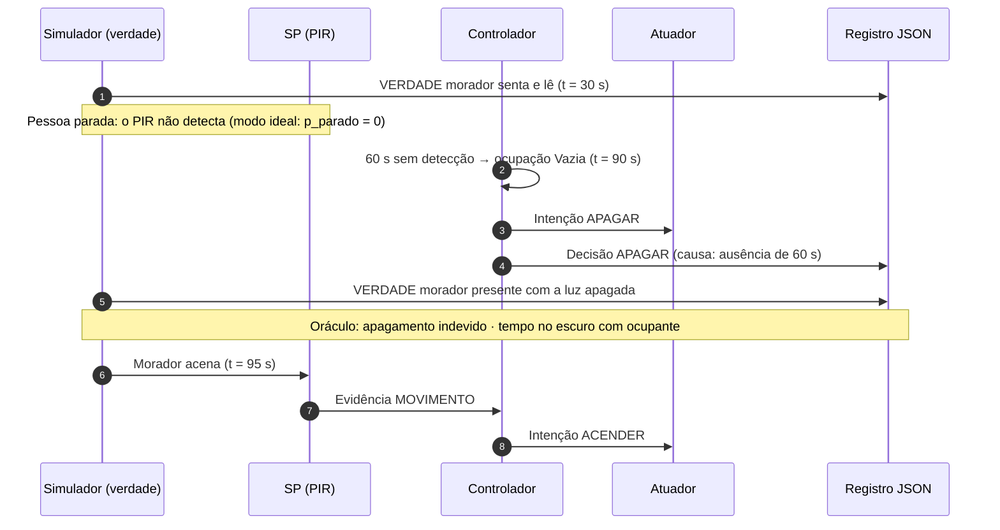
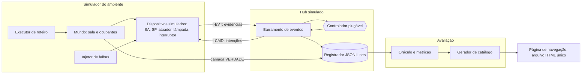

# Plano do ambiente de simulação — Incremento 0

**Documento:** ambiente-simulacao-v02.md
**Versão:** 02 | **Data:** 24/10/2026 (v01 de 23/10/2026)
**Disciplina:** PCS5039 — Engenharia de Software Orientada a IoT (EPUSP)
**Projeto de referência:** automação de iluminação residencial Reg10k, em ambiente simulado
**Repositório:** https://github.com/ReginaldoArakaki/PCS5039_ambiente_reg10k_vCl0
**Base:** V1 Business Drivers v02 [R13] e V2/V3 Requisitos v02 [R14]. As respostas às dúvidas do incremento 0 foram recebidas em 23/10/2026.
**Situação:** plano aprovado e implementado na versão 0 do repositório. As revisões RV-01 a RV-03 foram aprovadas em 24/10/2026 e incorporadas à V1 e à V2/V3 v02.

---

## Histórico de versões

| Versão | Data | Alterações |
|---|---|---|
| 01 | 23/10/2026 | Plano do incremento 0 |
| 02 | 24/10/2026 | Revisões RV-01 a RV-03 aprovadas e incorporadas à V1 e à V2/V3 v02; PI-02 resolvida; referências atualizadas para as versões 02 e para o repositório ReginaldoArakaki/PCS5039_ambiente_reg10k_vCl0. O comportamento do incremento 0 não muda |

---

## Sumário

1. Decisões que orientam o incremento
2. Objetivo e posição na trilha incremental
3. Escopo e rastreabilidade com V1–V3
4. Ambiente simulado
5. Regras de controle de referência
6. Modelos UML do incremento
7. Arquitetura de software
8. Registro em JSON
9. Catálogo de cenários
10. Métricas e critérios de aceitação
11. Página de navegação
12. Repositório e integração contínua
13. Roteiro didático e cronograma
14. Critérios de pronto
15. Riscos, pendências e próximos incrementos
16. Referências

---

## 1. Decisões que orientam o incremento

### 1.1 Decisões aprovadas

| ID | Decisão | Origem |
|---|---|---|
| DI-01 | O professor recebe uma referência completa (modelos, código, testes). Os alunos recebem um roteiro com partes a construir ou alterar | Resposta 1 |
| DI-02 | Diagramas obrigatórios: casos de uso, classes, estados (sala e luz), sequência (2 a 3 cenários) e componentes | Resposta 2 |
| DI-03 | Interface única de controlador, para que os alunos pluguem controladores próprios e os comparem no mesmo catálogo | Resposta 3 |
| DI-04 | Incremento 0 com 3 dias de duração; incrementos seguintes a cada 2 dias | Resposta 4 |
| DI-05 | Sala retangular; SA no batente da porta; SP num canto cobrindo cerca de 90% da área, com ponto cego conhecido | Resposta 5 |
| DI-06 | SP parametrizável, começando como PIR (sensor de movimento infravermelho) | Resposta 6 |
| DI-07 | Lâmpada com observação de efeito, incluindo a falha "lâmpada queimada" | Resposta 7 |
| DI-08 | Interruptor manual com precedência temporária | Resposta 8 |
| DI-09 | Sem luz natural nem hora do dia neste incremento | Resposta 9 |
| DI-10 | **O cachorro é o segundo morador.** É de grande porte, e a automação funciona para ele também | Respostas 10 e 11 |
| DI-11 | Ações do morador: entrar, sair, andar, ficar parado, passar pela porta sem entrar e usar o interruptor. Sem app e sem comando remoto | Resposta 12 |
| DI-12 | Apagamento após 60 s sem detecção (configurável) e contingência para presença desconhecida | Resposta 13 |
| DI-13 | Sensor sem resposta: manter o estado, sinalizar "desconhecida" e nunca apagar por silêncio | Resposta 14 |
| DI-14 | Repertório de cerca de 20 cenários (normais, falsos positivos, falsos negativos e falhas) | Resposta 15 |
| DI-15 | Três camadas (verdade, percepção, decisão) e métricas de desperdício, tempo no escuro, apagamentos indevidos e latência | Resposta 17 |
| DI-16 | Página HTML única, sem instalação, com quatro abas: Modelo, Cenários, Animação e Painel | Resposta 17 (navegação) |
| DI-17 | O motor em Python gera os JSON e a página os reproduz. A página tem um editor que gera roteiros, mas não executa a simulação | Respostas 18 e 19 |
| DI-18 | Código no repositório ReginaldoArakaki/PCS5039_ambiente_reg10k_vCl0 | Resposta 20 |

### 1.2 Consequência da decisão DI-10

As respostas 10 e 15 se cruzam. A resposta 15 aprovou "cachorro sozinho" como falso positivo, mas a resposta 10 fez do cachorro um morador. **Prevalece a resposta 10**, que é mais específica e foi reforçada pela resposta 11. Daí decorre:

- **"Cachorro sozinho na sala com a luz acesa" passa a ser comportamento correto.** O cenário migra de falso positivo para normal (N05).
- **"Cachorro deitado dormindo e a luz apaga" vira falso negativo** (FN05), pelo mesmo motivo que vale para uma pessoa parada.
- **Entra uma nova regra:** RN-I0-01, "ocupante é pessoa ou animal de grande porte". Ela foi incorporada à V1 v02 como RN34 (decisão A12, §15.2).
- **O falso positivo que sai é reposto** por "disparo espúrio do SA" (FP03), mantendo os 20 cenários.

### 1.3 Ajuste de parâmetro em relação à V1

| Parâmetro | Na V1 | No incremento 0 | Motivo |
|---|---|---|---|
| PS05 — ausência estável | Duas leituras de ausência separadas por ≥ 3 s | **T_apagamento = 60 s** sem nenhuma detecção (configurável por cenário) | Com PIR, 3 s apagaria a luz de quem está sentado. Proposta de revisão da V1 em §15.2 |

---

## 2. Objetivo e posição na trilha incremental

**Objetivo:** dar aos alunos, já no primeiro incremento, o ciclo completo de engenharia (negócio, classes, componentes, implementação, integração e testes) num sistema pequeno o bastante para ser entendido inteiro. O sistema é uma sala com uma porta, dois moradores (uma pessoa e um cachorro de grande porte), três dispositivos e uma lâmpada. Ele deve tornar visíveis as diferenças entre o que **acontece** (verdade), o que os **sensores percebem** (percepção) e o que o **controle decide** (decisão).

### 2.1 Trilha

| Inc. | Dias | Acrescenta | Conceito novo |
|---|---|---|---|
| **0** | **1–3** | 1 sala, 1 porta, 1 pessoa, 1 cachorro; SA, SP, atuador, lâmpada e interruptor; registro JSON e painel | Ciclo completo; percepção ≠ verdade; falsos positivos e negativos |
| 1 | 4–5 | 2º cômodo e a passagem entre eles | Inferência com mais de uma porta; classe Passagem |
| 2 | 6–7 | Mais pessoas e um visitante | Ocupação múltipla; "um sai e outro fica" |
| 3 | 8–9 | Plataforma, gêmeo L/R, app e desconexão | Sincronização, idempotência, comandos vencidos |
| 4 | 10–11 | Casa A (4 cômodos) | Escala; parâmetros por cômodo |
| 5 | 12–13 | Casa B (7 cômodos) e aprendizado do gêmeo | Modelo comportamental; sugestões com aceite |

**Princípio de continuidade:** os eventos do incremento 0 já seguem as classes da V2 (`Evidencia`, `Intencao`, `Decisao`, `ResultadoAtuacao`, `EstadoComodo`). No incremento 3, o gêmeo será uma leitura desse mesmo registro, sem mudar o formato.

---

## 3. Escopo e rastreabilidade com V1–V3

### 3.1 Dentro e fora

| Dentro | Fora (incremento indicado) |
|---|---|
| Decisão local de iluminação no hub | Plataforma remota e gêmeo (3) |
| Interruptor manual com precedência | App e comando remoto (3) |
| Classificação do resultado da atuação | Comissionamento, assinatura, membros (fora da trilha de simulação) |
| Saúde dos dispositivos (sem resposta, bateria) | Mais cômodos e passagens (1, 4, 5) |
| Registro imutável em JSON e oráculo de avaliação | Mais pessoas (2) |
| Página de navegação e painel | Luz natural e hora do dia (a definir) |

### 3.2 O que da V1–V3 este incremento realiza

| Artefato V1–V3 | Como aparece no incremento 0 |
|---|---|
| RF-OPR-01 Decisão local | Controlador de referência (§5) |
| RF-OPR-02 Intervenção manual | Interruptor com precedência de 15 min (RN-I0-05) |
| RF-OPR-04 Classificação do resultado | Lâmpada com observação de efeito; falhas F03 e F04 |
| RF-OPR-05 Efeito único | Chave por intenção; reenvio após reinício do hub (F05) |
| RF-OPR-09 Saúde dos dispositivos | Heartbeat do SP; bateria (F01, F02) |
| RF-SYN-01 Publicação com ordem e relógio | Envelope de evento com `seq` e `relogio_confiavel` (§8) |
| RF-GOV-05 Registros imutáveis | Registro em JSON Lines, somente acréscimo |
| RNF-DES-03 Reação local p95 ≤ 500 ms | Métrica de latência (§10) |
| RNF-CON-01 Autonomia local | Todo o incremento opera sem plataforma |
| RNF-USA-03 Transparência da incerteza | Painel mostra ocupação "desconhecida" e o nível de evidência |
| RN01, RN02, RN07, RN09, RN12 | Regras RN-I0-03 a RN-I0-08 |
| INV-06, INV-08, INV-09 | Invariantes verificadas pelo oráculo (§10.3) |
| CV02, CV03, CV04, CV08, CV15 | Cenários N01 (CV02), F01 (CV03), F03 e F04 (CV04), N04 (CV08), N03 e FN02 (CV15) |
| CF05 | Reproduzido integralmente (N01 e F01) |

---

## 4. Ambiente simulado

### 4.1 Planta da sala

```
          x=0                                     x=5 m
   y=4 m  ┌───────────────────────────────────────┐ ◤ SP (canto NE, aponta para SO,
          │                                       │    cobre ≈ 90% da sala)
          │                                       │
          │                 ( L )                 ░
          │               lâmpada                 ░  Z1: zona cega
          │                                       ░  (1,0 × 2,0 m junto à
          │                                       ░   parede leste, y = 0 a 2)
   y=0 m  └──[ porta ]─────────────────────────────┘
            x=0,5 a 1,4
            SA no batente · I = interruptor ao lado da porta (x = 1,6)
   (exterior abaixo da porta)
```

| Elemento | Especificação |
|---|---|
| Sala | 5,0 × 4,0 m (20 m²), grade de simulação de 0,1 m |
| Porta | Parede sul, x = 0,5 a 1,4 m; liga a sala ao exterior |
| SA | Feixe no batente da porta; detecta o cruzamento, sem direção (RN09) |
| SP | PIR no canto nordeste (5,0; 4,0), alcance de 6 m e abertura de 90° |
| Zona cega Z1 | Faixa de 1,0 × 2,0 m junto à parede leste (x = 4,0 a 5,0; y = 0 a 2,0): 2 m², 10% da área |
| Lâmpada | Centro da sala; atuador (relé) mais sensor de efeito (fotodiodo) |
| Interruptor | Ao lado da porta; gera um evento manual |
| Exterior | Nó sem sensores nem iluminação |

### 4.2 Ocupantes

| Ocupante | Porte | Ações possíveis | Assinatura para os sensores |
|---|---|---|---|
| Morador (pessoa) | Adulto | Entrar, sair, andar, ficar parado (ler, TV, dormir), passar pela porta sem entrar, usar o interruptor | Movimento forte ao andar; quase nenhum parado |
| Rex (cachorro) | Grande porte (≈ 35 kg) | Entrar, sair, andar, deitar, dormir; passa pela porta sozinho | Movimento forte ao andar; nenhum ao dormir |

Os sensores não distinguem pessoa de cachorro (RN09). Só a camada de verdade sabe quem é quem.

### 4.3 Modelos dos dispositivos

Cada parâmetro tem um valor para o **modo ideal**, que valida a lógica, e outro para o **modo realista**, com ruído. Todos são configuráveis por cenário.

| Dispositivo | Parâmetro | Ideal | Realista |
|---|---|---|---|
| SA | Probabilidade de detectar um cruzamento | 1,00 | 0,98 (0,85 se a velocidade for > 2 m/s) |
| SA | Tempo de rearme (cruzamentos em sequência contam como um) | 2 s | 2 s |
| SA | Latência | 50 ms | 50–150 ms |
| SA | Disparo espúrio | 0 | 1 a cada 4 h |
| SP (PIR) | Detecção de movimento na área coberta (por janela de 1 s) | 1,00 | 0,95 |
| SP (PIR) | Detecção de ocupante parado (por janela de 1 s) | 0,00 | 0,02 |
| SP (PIR) | Detecção de microgestos (TV, leitura) | 0,00 | 0,30 a cada gesto |
| SP (PIR) | Na zona cega Z1 | 0,00 | 0,00 |
| SP (PIR) | Tempo de retenção do sinal | 5 s | 5 s |
| SP (PIR) | Latência | 500 ms | 0,5–1,5 s |
| SP (PIR) | Falso disparo (calor ou corrente de ar) | 0 | 1 a cada 6 h; forçado em FP02 |
| SP (PIR) | Heartbeat | A cada 10 s | A cada 10 s |
| SP (PIR) | Bateria | 100% | Decai; abaixo de 15% a detecção cai para 0,60 |
| Atuador | Confirmação de execução | 100 ms | 100–300 ms |
| Lâmpada | Tempo até o efeito ser observado | 200 ms | 200–600 ms |
| Hub | Relógio | Confiável | Deriva de ±50 ppm; salto de relógio em F06 |

A simulação avança em passos de **100 ms**. Cada execução usa uma **semente aleatória** registrada, e a mesma semente reproduz a mesma execução, byte a byte.

---

## 5. Regras de controle de referência

### 5.1 Regras de negócio do incremento

| ID | Regra | Origem |
|---|---|---|
| RN-I0-01 | **Ocupante** é pessoa ou animal de grande porte. A automação atende a qualquer ocupante | DI-10 |
| RN-I0-02 | Com a luz apagada e sem precedência manual, qualquer detecção válida (SA ou SP) **acende**. Prioriza-se o conforto: o SA acende antes do SP confirmar | RF-OPR-01 |
| RN-I0-03 | A luz **apaga** após T_apagamento (60 s) sem nenhuma detecção, se não houver precedência manual e a ocupação não estiver "desconhecida" | DI-12; PS05-I0 |
| RN-I0-04 | Se o SP ficar sem heartbeat por 30 s, a ocupação passa a **desconhecida**: o estado da luz é mantido, nunca se apaga por silêncio, e o fato é sinalizado | DI-13; RN01 |
| RN-I0-05 | Acionar o interruptor cria **precedência manual por 15 min** (PS03). Apagar manualmente suspende o acendimento automático; acender manualmente suspende o apagamento automático | DI-08; RF-OPR-02 |
| RN-I0-06 | Toda atuação é classificada: execução relatada (confirmação do atuador) e efeito observado (sensor da lâmpada) em até 10 s (PS02). Sem confirmação, o resultado é **desconhecido** | RF-OPR-04; RN02 |
| RN-I0-07 | Sem confirmação do atuador, há **uma nova tentativa** após 2 s, com a mesma chave de intenção. Persistindo a falha, a atuação é sinalizada | RF-OPR-05 |
| RN-I0-08 | Depois de um reinício, o hub começa com ocupação desconhecida, lê o estado da lâmpada pelo sensor de efeito e registra uma **lacuna** no período em que esteve fora | RN12 |

### 5.2 Parâmetros

| Parâmetro | Valor padrão | Configurável |
|---|---|---|
| T_apagamento | 60 s | Sim |
| T_manual (PS03) | 15 min | Sim |
| T_heartbeat_falha | 30 s (3 heartbeats perdidos) | Sim |
| T_confirmacao (PS02) | 10 s | Sim |
| T_retentativa | 2 s, uma vez | Sim |
| Validade da evidência (PS04) | 10 s | Sim |

### 5.3 Limitações conhecidas da referência

Estas limitações são **intencionais**. Elas formam o material dos exercícios (§13.2):

- **Passagem pela porta sem entrar** acende a luz por 60 s (FP01), porque o SA não sabe a direção.
- **Ocupante parado** (lendo, dormindo ou na zona cega) fica no escuro depois de 60 s (FN01, FN03, FN05).
- **Assistir TV** com movimentos esparsos provoca ciclos de apagar e reacender (FN02).

---

## 6. Modelos UML do incremento

### 6.1 Casos de uso



**Figura 1 — Casos de uso do incremento 0.** Mermaid não tem notação própria de casos de uso, então eles aparecem como elipses num fluxograma. No repositório, o mesmo diagrama também existe em PlantUML.

### 6.2 Classes



**Figura 2 — Classes do incremento 0.** `Evidencia`, `Intencao`, `ResultadoAtuacao` e `EstadoSala` (que corresponde ao `EstadoComodo` da V2) seguem a V2. `Ocupante` e suas subclasses só existem na camada de verdade do simulador; o hub nunca os vê.

### 6.3 Estados da ocupação inferida



**Figura 3 — Ocupação inferida pelo controlador.** A verdade pode ser diferente desse estado; medir essa diferença é o objetivo do painel.

### 6.4 Estados da luz



**Figura 4 — Estados da luz.** Cada transição gera uma `Intencao`, e o resultado é classificado conforme a RN-I0-06.

### 6.5 Sequência — N01: morador entra na sala vazia



**Figura 5 — Cenário N01.**

### 6.6 Sequência — FN01: morador lê parado e a luz apaga



**Figura 6 — Cenário FN01**, uma limitação conhecida e documentada.

---

## 7. Arquitetura de software

### 7.1 Componentes



**Figura 7 — Componentes do incremento 0.**

| Componente | Responsabilidade | Pacote Python |
|---|---|---|
| Executor de roteiro | Lê o roteiro JSON e move os ocupantes no tempo | `sim.roteiro` |
| Mundo | Posições, movimento e presença real (camada de verdade) | `sim.mundo` |
| Dispositivos simulados | Modelos da §4.3, nos modos ideal e realista | `sim.dispositivos` |
| Injetor de falhas | Ativa as falhas F01–F06 em instantes do roteiro | `sim.falhas` |
| Barramento | Entrega evidências ao controlador e intenções aos dispositivos, com `seq` e relógio do hub | `hub.barramento` |
| Controlador | Interface única (§7.2) e controlador de referência (§5) | `hub.controlador` |
| Registrador | Grava todas as camadas, somente acréscimo | `hub.registro` |
| Oráculo e métricas | Compara verdade e decisão, calcula métricas e verifica asserções | `avaliacao` |
| Gerador de catálogo | Roda todos os cenários e gera o catálogo e a página | `catalogo` |
| Página | Navegação offline (§11) | `site/` (gerado) |

### 7.2 Interface do controlador

É o contrato que os alunos implementam.

```python
from typing import Protocol

class Controlador(Protocol):
    nome: str

    def iniciar(self, config: "ConfigSala") -> None:
        """Recebe parâmetros (§5.2) e a descrição da sala."""

    def ao_evento(self, ev: "Evidencia", agora_ms: int) -> list["Intencao"]:
        """Chamado a cada evidência (SA, SP, interruptor, heartbeat, resultado)."""

    def ao_tick(self, agora_ms: int) -> list["Intencao"]:
        """Chamado a cada 100 ms; usado para temporizações."""

    def estado(self) -> "EstadoSala":
        """Ocupação inferida, luz, precedência e idade da última evidência."""
```

**Regras do contrato:**

- O controlador **não acessa a camada de verdade**.
- Toda `Intencao` declara `causa` e `regra`, para que o painel explique cada decisão.
- O controlador não pode guardar estado fora do próprio objeto, o que garante execuções reproduzíveis.
- A escolha do controlador é feita por linha de comando: `python -m sim --controlador alunos.grupo3:MeuControlador`.

---

## 8. Registro em JSON

### 8.1 Arquivos por cenário

| Arquivo | Formato | Papel |
|---|---|---|
| `sala.json` | JSON | Estrutura: dimensões, porta, dispositivos, zona cega, parâmetros |
| `roteiros/<ID>.json` | JSON | Entrada: ações dos ocupantes e falhas ao longo do tempo |
| `saida/<ID>/<controlador>/<semente>/eventos.jsonl` | JSON Lines | Todas as camadas, um evento por linha |
| `esperado/<ID>.json` | JSON | Oráculo: asserções no formato dado/quando/então |
| `saida/<ID>/<controlador>/<semente>/metricas.json` | JSON | Métricas e resultado das asserções |
| `catalogo.json` | JSON | Índice de cenários, execuções e requisitos rastreados |
| `schemas/*.schema.json` | JSON Schema | Validação de todos os arquivos acima |

### 8.2 Camadas do evento

| Camada | Quem gera | Classe V2 correspondente |
|---|---|---|
| `VERDADE` | Simulador | — (exclusiva do oráculo) |
| `PERCEPCAO` | Dispositivos | `Evidencia` |
| `DECISAO` | Controlador | `Decisao` e `Intencao` |
| `ATUACAO` | Atuador e lâmpada | `ResultadoAtuacao` |
| `ESTADO` | Controlador, a cada 1 s e a cada mudança | `EstadoComodo` |
| `SISTEMA` | Hub e injetor | Falha, reinício, lacuna, relógio |

### 8.3 Exemplos

**Roteiro (`roteiros/N01.json`):**

```json
{
  "id": "N01",
  "titulo": "Morador entra na sala vazia",
  "tipo": "NORMAL",
  "duracao_ms": 120000,
  "estado_inicial": {"ocupantes_na_sala": [], "luz": "APAGADA"},
  "acoes": [
    {"t_ms": 5000, "ocupante": "morador", "acao": "ENTRAR"},
    {"t_ms": 6000, "ocupante": "morador", "acao": "ANDAR", "ate": [2.5, 2.0], "vel_m_s": 1.0},
    {"t_ms": 10000, "ocupante": "morador", "acao": "ANDAR_ALEATORIO", "duracao_ms": 100000}
  ],
  "falhas": [],
  "requisitos": ["RF-OPR-01", "RNF-DES-03", "CV02", "CF05"]
}
```

**Eventos (`eventos.jsonl`, uma linha por evento):**

```json
{"id":"N01-42-000051","t_ms":5000,"seq":51,"camada":"VERDADE","tipo":"CRUZOU_PORTA","ocupante":"morador","sentido":"ENTRADA"}
{"id":"N01-42-000052","t_ms":5050,"seq":52,"camada":"PERCEPCAO","origem":"SA-01","tipo":"PASSAGEM","relogio_hub_ms":5050,"relogio_confiavel":true}
{"id":"N01-42-000053","t_ms":5051,"seq":53,"camada":"DECISAO","tipo":"INTENCAO","acao":"ACENDER","causa":"PASSAGEM_SA","regra":"RN-I0-02","precedencia":"AUTOMATICA","chave":"I-0001"}
{"id":"N01-42-000055","t_ms":5400,"seq":55,"camada":"ATUACAO","tipo":"RESULTADO","chave":"I-0001","nivel":"EFEITO_OBSERVADO"}
{"id":"N01-42-000060","t_ms":6000,"seq":60,"camada":"ESTADO","ocupacao":"OCUPADA","luz":"ACESA_AUTO","precedencia":"AUTOMATICA","idade_evidencia_ms":400}
```

**Esperado (`esperado/N01.json`):**

```json
{
  "cenario": "N01",
  "modo": "IDEAL",
  "assercoes": [
    {"id": "A1", "dado": "sala vazia e luz apagada", "quando": "morador cruza a porta em t=5000",
     "entao": {"tipo": "luz", "valor": "ACESA", "ate_ms": 6000}},
    {"id": "A2", "entao": {"tipo": "metrica", "nome": "latencia_reacao_ms_p95", "max": 500}},
    {"id": "A3", "entao": {"tipo": "metrica", "nome": "apagamentos_indevidos", "max": 0}}
  ]
}
```

**Métricas (`metricas.json`):**

```json
{
  "cenario": "N01", "controlador": "referencia", "semente": 42, "modo": "IDEAL",
  "metricas": {"desperdicio_s": 0.0, "escuro_com_ocupante_s": 0.4, "apagamentos_indevidos": 0,
               "acionamentos": 1, "latencia_reacao_ms_p95": 51},
  "assercoes": {"A1": "PASSOU", "A2": "PASSOU", "A3": "PASSOU"}
}
```

### 8.4 Regras do registro

- O registro é **somente acréscimo**. Correções viram novos eventos (INV-06).
- `t_ms` é o tempo do simulador (verdade). `relogio_hub_ms` é o relógio do hub, que pode divergir em F06.
- `seq` é monotônico por execução e define a ordem, mesmo se o relógio do hub saltar.
- O `id` é composto por cenário, semente e `seq`, para que execuções possam ser comparadas linha a linha.

---

## 9. Catálogo de cenários

**Como ler a tabela:** "Ideal" é o que um sistema perfeito faria. "Referência" é o que o controlador de referência faz, e é isso que as asserções verificam. Nos cenários de exceção, a diferença entre os dois é a limitação documentada. Os cenários rodam no modo ideal, salvo indicação, e cada um dura de 2 a 30 minutos.

### 9.1 Normais

| ID | Cenário | Ideal | Referência (asserções) | Rastreia |
|---|---|---|---|---|
| N01 | Morador entra na sala vazia | Acende ao entrar | Acende em ≤ 1 s; latência p95 ≤ 500 ms | RF-OPR-01; CV02; CF05 |
| N02 | Morador sai e a sala fica vazia | Apaga ao sair | Apaga 60 s ± 1 s após a última detecção; desperdício ≤ 90 s | RF-OPR-01 |
| N03 | Morador anda pela sala por 10 min | Acesa sem interrupção | 0 apagamentos indevidos | RF-OPR-01 |
| N04 | Morador apaga no interruptor para ver um filme e, mais tarde, acende manualmente e sai | Respeita a vontade | Não reacende por 15 min após apagar; não apaga por 15 min após acender | RF-OPR-02; CV08 |
| N05 | Cachorro entra sozinho e anda | Acende (ocupante) | Acende em ≤ 1 s | RN-I0-01 |
| N06 | Morador sai e o cachorro fica andando | Mantém acesa | 0 apagamentos indevidos | RN-I0-01 |

### 9.2 Falsos positivos

| ID | Cenário | Ideal | Referência (asserções) | Rastreia |
|---|---|---|---|---|
| FP01 | Morador passa pela porta sem entrar (pega algo e volta) | Não acende | Acende e apaga após 60 s; desperdício ≈ 60 s | RN09; §5.3 |
| FP02 | Corrente de ar quente dispara o PIR com a sala vazia | Não acende | Acende e apaga após 60 s | Modelo do SP |
| FP03 | Disparo espúrio do SA (ruído elétrico) com a sala vazia | Não acende | Acende e apaga após 60 s | Modelo do SA |

### 9.3 Falsos negativos

| ID | Cenário | Ideal | Referência (asserções) | Rastreia |
|---|---|---|---|---|
| FN01 | Morador senta e lê parado por 10 min | Mantém acesa | Apaga 60 s após o último movimento; reacende ao gesto | RF-OPR-01; Figura 6 |
| FN02 | Morador vê TV com microgestos esparsos (modo realista) | Mantém acesa | Ciclos de apagar e reacender; conta os apagamentos indevidos | CV15 |
| FN03 | Morador fica na zona cega Z1 | Mantém acesa | Apaga após 60 s | DI-05 |
| FN04 | Entrada rápida em que o SA falha (modo realista, velocidade > 2 m/s) | Acende ao entrar | Acende só pelo SP, com atraso de 0,5 a 1,5 s; mede o tempo no escuro | Modelo do SA |
| FN05 | Cachorro deita e dorme por 20 min | Mantém acesa (é ocupante) | Apaga após 60 s | RN-I0-01; DI-10 |

### 9.4 Falhas

| ID | Cenário | Ideal | Referência (asserções) | Rastreia |
|---|---|---|---|---|
| F01 | SP deixa de responder com o morador na sala | Mantém e avisa | Após 30 s, ocupação desconhecida; não apaga; evento de saúde | RN-I0-04; RN01; CV03 |
| F02 | Bateria do SP cai abaixo de 15% | Avisa antes de falhar | Evento de bateria baixa; detecção degradada medida | RF-OPR-09 |
| F03 | Lâmpada queimada | Detecta a divergência | Execução relatada sem efeito observado; resultado desconhecido | RN-I0-06; CV04 |
| F04 | Atuador não confirma (relé travado) | Tenta de novo e avisa | Uma nova tentativa com a mesma chave; depois, falha sinalizada | RN-I0-07; RF-OPR-05 |
| F05 | Hub reinicia por 20 s no meio do cenário | Retoma sem perder o controle | Lacuna registrada; reinicia em desconhecida; lê a lâmpada; retoma | RN-I0-08 |
| F06 | Relógio do hub salta −5 min | Ordem preservada | `relogio_confiavel=false`; ordem por `seq`; métricas pelo tempo do simulador | RF-SYN-01 |

**Total:** 6 normais, 3 falsos positivos, 5 falsos negativos e 6 falhas, ou seja, 20 cenários.

---

## 10. Métricas e critérios de aceitação

### 10.1 Métricas

| Métrica | Definição | Fonte |
|---|---|---|
| Desperdício (s) | Tempo com luz acesa e nenhum ocupante na sala | Verdade × atuação |
| Escuro com ocupante (s) | Tempo com ocupante na sala e luz apagada, excluindo a precedência de apagar manual | Verdade × atuação |
| Apagamentos indevidos (n) | Transições de acesa para apagada com ocupante presente, sem comando manual | Verdade × decisão |
| Acionamentos (n) | Número de intenções executadas (comparativo, sem limite) | Decisão |
| Latência de reação (ms, p95) | Da evidência ao comando para o atuador | Percepção × decisão |
| Atraso percebido (ms) | Do ocupante cruzar a porta até o efeito observado na lâmpada | Verdade × atuação |

### 10.2 Limites (modo ideal, cenários normais)

| Métrica | Limite | Origem |
|---|---|---|
| Latência de reação p95 | ≤ 500 ms | RNF-DES-03 |
| Escuro com ocupante após entrar | ≤ 1 s | Proposta anterior, aceita |
| Desperdício por saída | ≤ T_apagamento + 30 s = 90 s | Idem |
| Apagamentos indevidos | 0 | Idem |

Nos **cenários de exceção**, as asserções verificam o comportamento documentado da referência (testes de caracterização). As métricas mostram o tamanho da limitação. No **modo realista**, cada cenário roda com 30 sementes, e o painel mostra a distribuição.

### 10.3 Invariantes verificadas pelo oráculo em todas as execuções

| ID | Verificação | Base |
|---|---|---|
| OR-01 | Nenhum evento é alterado ou removido; `seq` é estritamente crescente | INV-06 |
| OR-02 | O nível de resultado nunca passa da capacidade da lâmpada | INV-08 |
| OR-03 | Ocupação inferida "vazia" só ocorre depois de 60 s sem detecção e com o SP saudável | INV-09 ajustada |
| OR-04 | Nenhum apagamento automático com ocupação desconhecida | RN01 |
| OR-05 | Cada chave de intenção produz no máximo um efeito | RF-OPR-05 |
| OR-06 | O controlador nunca recebe eventos da camada de verdade | Contrato §7.2 |

---

## 11. Página de navegação

A página é um único arquivo `index.html` **gerado com os dados embutidos**. Ela abre com duplo clique, sem servidor, sem internet e sem instalação. Os diagramas são pré-renderizados em SVG durante a geração.

| Aba | Conteúdo | Interações |
|---|---|---|
| **Modelo** | Diagramas da §6; regras RN-I0; tabela de rastreabilidade V1–V3 | Clicar numa classe, regra ou requisito mostra onde aparece e quais cenários o exercitam |
| **Cenários** | Catálogo com tipo, resultado das asserções (passou ou falhou) e métricas, por controlador | Filtros por tipo, controlador e requisito; comparação lado a lado de dois controladores |
| **Animação** | Planta da sala com morador, cachorro, zona cega, raios do SA e SP, e a lâmpada acesa ou apagada | Reproduzir, pausar, passo a passo, velocidades 1× a 60×; linha do tempo clicável |
| **Painel** | Linha do tempo em faixas: verdade (quem está na sala), SA, SP, ocupação inferida, intenções, luz (comandada e observada), falhas; tabela de eventos; métricas | Cursor sincronizado com a animação; destaque de apagamentos indevidos e desperdício; exportação CSV e impressão em PDF |
| **Editor de roteiro** (dentro de Cenários) | Formulário de ações e falhas no tempo | Gera o `roteiros/<ID>.json`, que depois roda em Python |

---

## 12. Repositório e integração contínua

Repositório: **ReginaldoArakaki/PCS5039_ambiente_reg10k_vCl0**

```
PCS5039_ambiente_reg10k_v0/
├── README.md                    # como instalar, rodar e navegar
├── docs/
│   ├── ambiente-simulacao-v02.md
│   ├── uml/                     # fontes Mermaid e PlantUML da §6
│   └── roteiro-alunos.md        # exercícios da §13.2
├── sim/                         # simulador: roteiro, mundo, dispositivos, falhas
├── hub/                         # barramento, registrador, controlador de referência
├── avaliacao/                   # oráculo, métricas, asserções
├── catalogo/                    # gerador de catálogo e da página
├── alunos/                      # controladores dos grupos (um módulo por grupo)
├── cenarios/
│   ├── sala.json
│   ├── roteiros/                # N01 … F06
│   └── esperado/                # asserções
├── schemas/                     # JSON Schema
├── tests/                       # pytest: unidades e catálogo como teste
├── saida/                       # gerado (fora do controle de versão)
├── site/                        # index.html gerado
└── .github/workflows/ci.yml     # valida schemas, roda o catálogo, publica a página
```

**Integração contínua (GitHub Actions):** a cada envio de código, os JSON são validados contra os schemas, os 20 cenários rodam com o controlador de referência e com cada controlador em `alunos/`, a determinação é conferida (mesma semente, mesmo hash do `eventos.jsonl`), e a página é gerada como artefato. Um controlador de aluno que viole as invariantes OR-01 a OR-06 reprova a execução.

**Requisitos de ambiente:** Python 3.11 ou superior, apenas bibliotecas de uso comum (por exemplo, `jsonschema` e `pytest`), sem banco de dados nem broker de mensagens.

---

## 13. Roteiro didático e cronograma

### 13.1 Preparação (antes do dia 1, responsabilidade do professor)

| Item | Entrega |
|---|---|
| P1 | Referência completa no repositório: simulador, controlador, oráculo, 20 cenários, página |
| P2 | Diagramas da §6 versionados em `docs/uml` |
| P3 | `roteiro-alunos.md` com os exercícios da §13.2 |
| P4 | Integração contínua funcionando, com a referência aprovada |

### 13.2 Exercícios dos alunos

| Ex. | Atividade | Técnica de arquitetura | Cenários-alvo |
|---|---|---|---|
| E1 | Revisar o modelo de negócio do incremento: regras RN-I0 e a decisão sobre o cachorro; propor uma regra alternativa | Modelagem de negócio | N05, FN05 |
| E2 | Completar ou criticar os diagramas de classes e de estados | UML estrutural e comportamental | Todos |
| E3 | Implementar um **controlador alternativo** que reduza o falso positivo da porta. Por exemplo: o SA acende só se o SP confirmar em até 3 s | Componentização; interface | FP01, FN04 |
| E4 | Implementar um **tempo de apagamento adaptativo**, que espera mais quando houve entrada pela porta e nenhuma saída | Lógica de controle | FN01–FN03, FN05 |
| E5 | Criar 2 cenários novos com o editor, com as asserções correspondentes | Testes; catálogo | Novos |
| E6 | Comparar os controladores no painel e discutir os trade-offs (desperdício × escuro com ocupante) | Avaliação; integração | Catálogo inteiro |

### 13.3 Cronograma (3 dias)

| Dia | Manhã | Tarde | Entregável dos grupos |
|---|---|---|---|
| **1 — Negócio e modelos** | Apresentação do ambiente; execução da referência; navegação nas quatro abas | E1 e E2 | Regras revisadas; diagramas criticados; análise escrita de 3 cenários |
| **2 — Componentes e implementação** | Interface do controlador; padrões de teste | E3 e E4 | Controlador no diretório `alunos/` com a integração contínua aprovada |
| **3 — Integração e testes** | E5: novos cenários | E6: comparação e apresentação dos grupos; retrospectiva; preparação do incremento 1 | Relatório de 1 página com métricas comparadas; cenários novos no catálogo |

---

## 14. Critérios de pronto

| # | Critério | Como verificar |
|---|---|---|
| CP-01 | Os 20 cenários rodam com a referência e passam nas asserções | Integração contínua |
| CP-02 | Determinação: mesma semente gera o mesmo `eventos.jsonl` | Hash na integração contínua |
| CP-03 | Todos os JSON são válidos contra os schemas | Integração contínua |
| CP-04 | Invariantes OR-01 a OR-06 respeitadas em todas as execuções | Oráculo |
| CP-05 | A página abre offline e as quatro abas funcionam com os 20 cenários | Inspeção |
| CP-06 | Diagramas da §6 versionados e consistentes com o código (nomes de classes e estados) | Inspeção |
| CP-07 | Rastreabilidade da §3.2 navegável na aba Modelo | Inspeção |
| CP-08 | Um controlador de exemplo de aluno (por exemplo, do E3) roda pela interface sem mudanças no simulador | Integração contínua |

---

## 15. Riscos, pendências e próximos incrementos

### 15.1 Riscos

| Risco | Efeito | Mitigação |
|---|---|---|
| 3 dias é pouco para todos os exercícios | Grupos não chegam a E5 e E6 | E3 ou E4 obrigatório; E5 opcional; a referência pronta reduz o trabalho de base |
| Modelo do PIR pouco realista | Conclusões erradas sobre sensores reais | Parâmetros documentados e ajustáveis; o modo realista é explicitamente um modelo didático |
| Página pesada com execuções de 30 sementes | Abertura lenta | Embutir apenas a semente de referência; as demais ficam como métricas resumidas |
| Divergência entre diagramas e código | Perda de valor didático | CP-06; nomes de classes iguais nos dois |

### 15.2 Revisões da V1–V3

| ID | Revisão | Documento | Situação |
|---|---|---|---|
| RV-01 | Nova regra **RN34**: ocupante inclui animal de grande porte; a automação o atende | V1 §7.2 | Aprovada em 24/10/2026 (A12, V1 v02) |
| RV-02 | **PS05**: substituir "duas leituras com 3 s de intervalo" por "T_apagamento configurável, padrão de 60 s sem detecção" | V1 §9 e INV-09 da V2 | Aprovada em 24/10/2026 (A13, V1 e V2/V3 v02) |
| RV-03 | Classe **Passagem**, para o SA vinculado à porta (já identificada na conversa sobre as duas casas; necessária a partir do incremento 1) | V2 §2.2 | Aprovada em 24/10/2026 (A14, V2/V3 v02: classe Passagem, INV-15) |

### 15.3 Pendências

| ID | Pendência | Quando |
|---|---|---|
| PI-01 | Comportamento desejado com o ocupante **dormindo**: manter acesa ou aceitar apagar? Hoje FN05 trata o apagamento como indevido | Antes do incremento 2 |
| PI-02 | Aprovar as propostas RV-01 a RV-03 | **Resolvida em 24/10/2026** |
| PI-03 | Definir se os controladores dos alunos serão avaliados por métrica (ranking) ou por análise escrita | Dia 1 |

### 15.4 O que o incremento 1 herda

O incremento 1 reutiliza o simulador, o registro, o oráculo, a página e a interface do controlador sem mudanças de formato. Ele acrescenta a classe Passagem, um segundo cômodo e cenários de movimento entre cômodos, que é onde o SA sem direção passa a ser o problema central.

---

## 16. Referências

| ID | Documento |
|---|---|
| R13 | V1 — Business Drivers da Plataforma Reg10k, v02, 24/10/2026 |
| R14 | V2 e V3 — Requisitos funcionais e não funcionais da plataforma Reg10k, v02, 24/10/2026 |
| — | Respostas às dúvidas do incremento 0, 23/10/2026 |
| — | Respostas às dúvidas do ambiente de duas residências, 22/10/2026 (plano dos incrementos 4 e 5) |
