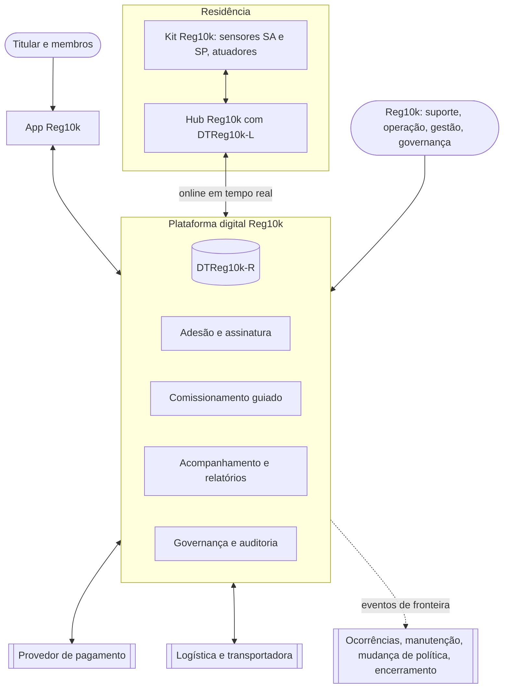
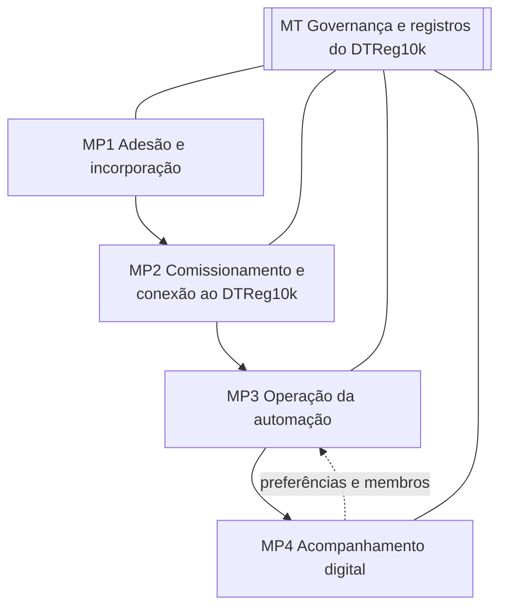
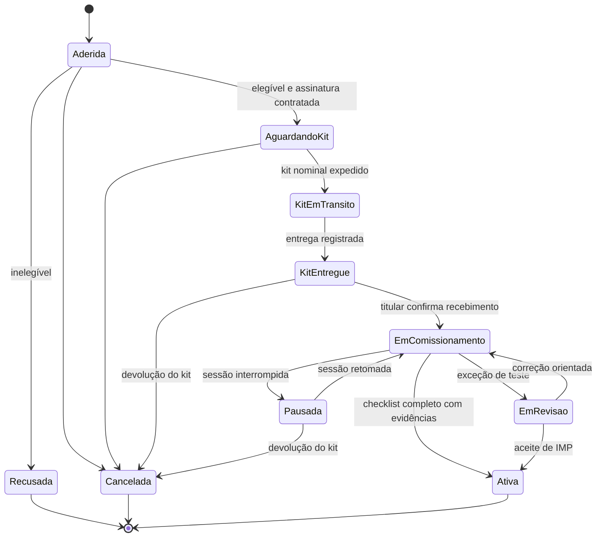
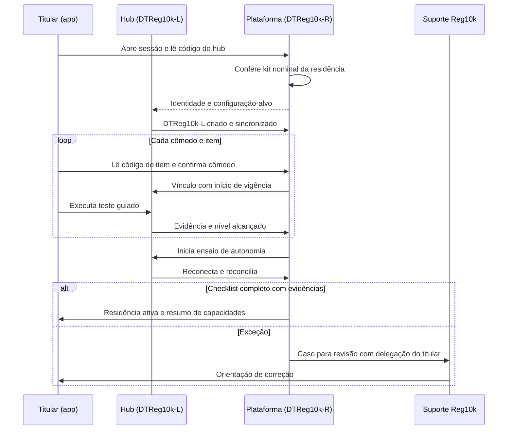
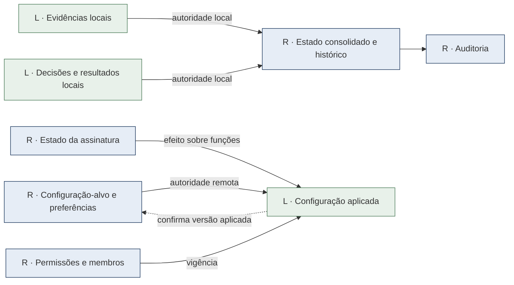

# V1 — Business Drivers da Plataforma Reg10k

**Documento:** v1-business-drivers-plataforma-reg10k-v02.md
**Versão:** 02 | **Data:** 24/10/2026 (v01 de 18/10/2026)
**Referencial:** RM-ODP adaptado. V1 Negócio, tratada como **Visão Business Drivers** [R08].
**Projeto:** engenharia da plataforma digital da Reg10k para 10.000 residências assinantes, com automação local e Digital Twin DTReg10k.
**Roteiro aplicado:** plano-v1-business-drivers-plataforma-v01.md [R12], etapas E1–E7.
**Situação:** modelagem para validação. As decisões marcadas **A** foram expressas pelo responsável pelo projeto. As demais são propostas (**P**) ou derivam de fontes (**F**). Nenhum número deste documento é medição.

---

## Histórico de versões

| Versão | Data | Alterações |
|---|---|---|
| 01 | 18/10/2026 | Primeira modelagem da Visão Business Drivers (A01–A08) |
| 02 | 24/10/2026 | D09 decidida (A09, kit sem fiação): RN25, MP2 passo 4, RNP-MP2-04, CV28 e interface de visita técnica reescritos; H05 confirmada. D13 decidida: I01 e I02 viram A10 e A11. Revisões aprovadas do plano do ambiente de simulação: RN34 (A12), PS05 com 60 s (A13) e SA vinculado à passagem (A14). Nenhuma alteração de contagem: 49 RNP e 23 cenários de aceitação |

---

## Sumário

1. Identificação e decisões vigentes
2. Contexto e fronteira da plataforma
3. Direcionadores de negócio (BD01–BD08)
4. Partes interessadas e papéis
5. Macroprocessos MP1–MP4
6. Governança e registros do DTReg10k (MT)
7. Regras de negócio
8. Requisitos de negócio da plataforma (RNP)
9. Qualidade, parâmetros e volumes
10. Cenários de aceitação
11. Interfaces com processos fora do foco
12. Rastreabilidade e encaminhamentos para V2–V5
13. Decisões pendentes e registro de validação
14. Referências

---

## 1. Identificação e decisões vigentes

### 1.1 Convenção

| Marca | Significado |
|---|---|
| **A** | Decisão expressa pelo responsável pelo projeto |
| **F** | Comportamento ou limite documentado nas fontes R01–R11 |
| **P** | Proposta desta modelagem, sujeita a aceite pelo papel indicado |
| **I** | Interpretação de uma decisão **A**, registrada para confirmação |

Salvo indicação, as definições deste documento são **P**.

### 1.2 Decisões aprovadas

| ID | Decisão | Origem | Efeito na V1 |
|---|---|---|---|
| A01 | Recursos aportados por investidores, com carta branca | R11 §0.1 | Custo não é critério eliminatório. Prazo, risco, qualidade e conformidade passam a ser os critérios |
| A02 | 10.000 clientes contratam por assinatura assim que o serviço estiver disponível | R11 §0.1 | Pico de adesão e incorporação no lançamento (BD01) |
| A03 | Arquitetura em cinco visões | R11 §0.1 | Esta V1 encaminha requisitos para V2–V5 (§12) |
| A04 | O projeto foca a **engenharia da plataforma** | R12 §1 | Requisitos escritos como capacidades que a plataforma oferece |
| A05 (D01) | A plataforma digital constitui uma empresa de operação: **a Reg10k** | Responsável pelo projeto, 18/10/2026 | Um único operador. Os papéis de operação, suporte e gestão pertencem à Reg10k |
| A06 (D02) | **Kit Reg10k com instalação DIY** (faça você mesmo) | Idem | O morador instala e comissiona. MP1 inclui expedição; MP2 é guiado pela plataforma |
| A07 (D03) | **Kit de referência Reg10k** | Idem | Capacidades conhecidas por modelo de item. Sem multifabricante no lançamento |
| A08 (D04) | A plataforma digital está conectada em tempo real, online, com o Digital Twin local e remoto: **o DTReg10k** | Idem | O DTReg10k tem duas representações sincronizadas (§6) |
| A09 (D09) | **Kit sem fiação**: o kit DIY contém só itens de encaixe ou plugáveis (lâmpadas e módulos), sem intervenção na instalação elétrica fixa. Pontos de luz que exigiriam fiação só com visita técnica opcional | Responsável pelo projeto, 24/10/2026 | RN25 e MP2 reescritos; H05 confirmada; a capacidade de observar o efeito passa a depender do modelo de item plugável (RF-KIT-01 da V2) |
| A10 (D13, ex-I01) | A plataforma **gerencia** a assinatura; o processamento do pagamento fica com provedor externo | Idem | RN27 e RN29 passam a se apoiar em decisão aprovada |
| A11 (D13, ex-I02) | "Tempo real" = sincronização DTReg10k-L → R com p95 ≤ 5 s (PS11) e comando remoto com p95 ≤ 3 s (PS12), sem dependência da conexão para a iluminação local | Idem | PS11 e PS12 deixam de ser propostas |
| A12 (RV-01) | **RN34**: ocupante é pessoa ou animal de grande porte; a automação o atende | Plano do ambiente de simulação v01 §15.2, aprovado em 24/10/2026 | Nova regra (§7.2) |
| A13 (RV-02) | **PS05**: ausência estável = T_apagamento configurável, padrão de 60 s sem nenhuma detecção | Idem | Substitui "duas leituras com 3 s de intervalo" (§9.1) |
| A14 (RV-03) | O sensor de passagem é vinculado a uma **passagem** (porta) entre dois cômodos, ou entre cômodo e exterior, e não a um cômodo | Idem | MP2 passo 3; classe Passagem na V2 |

### 1.3 Interpretação a confirmar

| ID | Interpretação | Motivo | Confirmar em |
|---|---|---|---|
| I03 | "Gestores" são os gestores da Reg10k (negócio, operação, qualidade). Um gestor externo (síndico ou administradora) só existe se D11 o confirmar | A05 indica operador único; o vínculo condominial não foi confirmado | D11 |

### 1.4 O que muda em relação a R10/R11

| Tema | Antes | Nesta V1 |
|---|---|---|
| Instalação | Equipes de campo (≈97 duplas em R11 CL10) | Morador instala; a Reg10k oferece suporte remoto. Visita técnica é exceção fora do foco |
| Incorporação | Técnico confere vínculo presencialmente (PN01.3) | Vínculo comprovado por **kit nominal** (pré-associado à residência), leitura de códigos e testes automáticos |
| Gargalo do lançamento | Capacidade de campo | Logística de expedição, sessões simultâneas de comissionamento e suporte remoto |
| Hardware | Equipamentos variados; capacidade declarada por instalação | Kit de referência; capacidade conhecida por modelo de item |
| Assinatura | Fora do escopo (R10) ou interface (R12) | Gerida pela plataforma (A10) |
| Gêmeo | Representações local e central (R03) | **DTReg10k-L** (no hub da casa) e **DTReg10k-R** (na plataforma), com autoridade definida por tipo de registro (RN27) |

---

## 2. Contexto e fronteira da plataforma

### 2.1 Visão de contexto

**Figura 1 — Contexto da plataforma Reg10k.** Os elementos com borda dupla são externos ou fora do foco desta V1.

### 2.2 Glossário mínimo

| Termo | Significado |
|---|---|
| Reg10k | Empresa operadora da plataforma (A05) |
| Kit Reg10k | Conjunto de referência: um hub e os dispositivos da residência (sensores de passagem SA, sensores de presença SP e atuadores de iluminação), identificados por número de série (A06, A07) |
| Kit nominal | Kit cujos números de série foram associados a uma residência antes da expedição (RN24) |
| Hub Reg10k | Controlador local que executa a automação e hospeda o DTReg10k-L |
| DTReg10k | Digital Twin da residência (A08). **DTReg10k-L**: representação local no hub. **DTReg10k-R**: representação remota na plataforma |
| Titular | Assinante responsável pela residência; pode convidar membros |
| Incorporação | Da adesão até o kit entregue e confirmado (MP1) |
| Comissionamento | Instalação guiada, vínculos, testes e ativação (MP2) |
| Ativação | Momento em que a residência passa a "ativa" e a assinatura começa a ser cobrada (RN20) |

### 2.3 Fronteira

| Dentro do foco | Fora do foco (interface, §11) |
|---|---|
| Adesão online, elegibilidade, assinatura e seus efeitos sobre o serviço | Processamento financeiro, emissão fiscal e cobrança judicial |
| Alocação de kit nominal, rastreio de expedição e confirmação de recebimento | Operação logística, estoque físico e transporte |
| Comissionamento DIY guiado, testes, ativação e suporte remoto à sessão | Visita técnica presencial |
| Operação da automação local e remota, sincronização DTReg10k-L/R | Atendimento de presença inesperada (central) |
| Acompanhamento por titular, membros e gestores Reg10k | Manutenção e troca de dispositivos; alteração de políticas da base; transferência e encerramento |
| Governança, registros, auditoria, privacidade | Política comercial (preços, planos) |

### 2.4 Premissas

| ID | Premissa | Situação | Validação |
|---|---|---|---|
| H01 | 10.000 residências ativas como base inicial, com margem de projeto de 5× para a plataforma | A02; margem **P** (D08) | SER |
| H02 | A residência possui internet própria (Wi-Fi ou cabo) para o hub | P; condição de elegibilidade (RN31) | SER |
| H03 | A iluminação essencial funciona localmente sem conexão externa | F (R03, R10 RN04) | Ensaio na ativação (PS14) |
| H04 | Configuração típica de 6 cômodos automatizados por residência: 1 SA por passagem, 1 SP e 1 atuador por cômodo | P; hipótese de dimensionamento herdada de R10/R11; SA por passagem conforme A14 | Catálogo de kits (A09) |
| H05 | O kit DIY não exige intervenção na instalação elétrica fixa | **A** (A09) | Catálogo de kits e certificações (V2 RNF-LEG-04) |
| H06 | Os kits são entregues ao longo de cerca de 4 semanas após a abertura das assinaturas | P; depende da logística | D14 |

---

## 3. Direcionadores de negócio

Os direcionadores derivam de DN01–DN06 [R10] e das decisões A01–A08. A prioridade relativa orienta escolhas de engenharia quando dois direcionadores conflitam.

| ID | Direcionador | Objetivo | Medida (indicador, §9.3) | Meta proposta | Dono | Processos | Prioridade |
|---|---|---|---|---|---|---|---|
| BD01 | Prontidão para 10.000 assinantes no lançamento | Absorver o pico de adesão e comissionamento sem degradar residências ativas | IQ14 vazão de adesão; IQ15 sessões simultâneas; IQ03 atualidade das ativas | Ensaio aprovado nos cenários CL-A e CL-C | SER | MP1, MP2 | 2 |
| BD02 | Autoinstalação bem-sucedida e segura | O morador conclui sozinho, com segurança, na maioria dos casos | IQ16 conclusão DIY sem visita; IQ17 tempo de comissionamento | ≥ 90% sem visita; mediana ≤ 2 h | SER | MP2 | 2 |
| BD03 | Autonomia e continuidade local | A casa funciona sem a plataforma | IQ04 continuidade local | ≥ 99% das ativações com ensaio de autonomia aprovado | OPE | MP2, MP3 | **1** |
| BD04 | Confiança no DTReg10k | Distinguir intenção, relato, observação e desconhecido; L e R coerentes | IQ02, IQ03, IQ18 sincronização L→R | Ver §9.3 | OPE | MP3, MP4, MT | **1** |
| BD05 | Transparência para usuários e gestores | Cada perfil vê o necessário, com atualidade e cobertura explícitas | IQ08 cobertura; uso do app (a definir) | Cobertura ≥ 95% | SER | MP4 | 3 |
| BD06 | Governança, privacidade e isolamento | Acesso por residência, finalidade e vigência; direitos do titular | IQ10 isolamento; IQ19 atendimento de direitos do titular | 100% das tentativas indevidas negadas; zero exposição confirmada | GOV | MT, MP4 | **1** |
| BD07 | Incorporação correta e rastreável | DTReg10k corresponde à residência e aos itens certos | IQ01 ativação válida; IQ11 integridade; IQ20 retrabalho de vínculo | 100%; zero vínculos cruzados | IMP | MP1, MP2, MT | **1** |
| BD08 | Escala e evolução sustentadas pelo investimento | Crescer além de 10.000 e de iluminação sem refazer a base | Margem ensaiada; tipos de dispositivo adicionáveis sem migração do DTReg10k | 5× em ensaio (D08) | SER | Todos | 3 |

**Leitura da prioridade:** 1 = inegociável (não se troca por prazo); 2 = condição de lançamento; 3 = pode evoluir após o lançamento. Assim, se houver conflito entre acelerar o lançamento (BD01) e preservar a correção do vínculo (BD07), prevalece BD07.

---

## 4. Partes interessadas e papéis

### 4.1 Papéis

| Código | Papel | Organização | Responsabilidade e limite |
|---|---|---|---|
| TIT | Titular da assinatura | Cliente | Contrata, instala o kit, define preferências, convida e revoga membros, exerce direitos de titular de dados |
| MEM | Membro da residência | Cliente | Usa e acompanha a casa conforme papel concedido pelo titular; não gerencia assinatura |
| OCU | Ocupante ou visitante | — | É detectado pelos sensores; não recebe permissão por estar presente; não é identificado (RN09) |
| SUP | Suporte remoto Reg10k | Reg10k | Assiste comissionamento e uso; acessa detalhes somente com delegação e vigência (PS10) |
| IMP | Responsável pela incorporação | Reg10k | Responde pelo processo MP1–MP2, pelas regras de ativação e pela revisão de exceções |
| LOGR | Responsável logístico Reg10k | Reg10k | Responde pela alocação de kits e pela integração com a transportadora |
| OPE | Responsável pela operação da plataforma | Reg10k | Responde pela confiabilidade do DTReg10k, sincronização e continuidade |
| SER | Responsável pelo serviço (produto) | Reg10k | Responde por direcionadores, metas, kits e políticas padrão |
| GES | Gestor Reg10k | Reg10k | Consulta agregados de negócio e qualidade; não acessa detalhe individual por padrão |
| COM | Responsável comercial | Reg10k | Responde por assinatura, cancelamento e relacionamento |
| GOV | Governança de dados (encarregado LGPD) | Reg10k | Define e verifica permissões, retenção, consentimentos e direitos do titular |

Sistemas externos: provedor de pagamento, transportadora, canais de mensagem (e-mail, push, SMS).

### 4.2 Responsabilidade por macroprocesso

| Macroprocesso | Responsável final | Executores | Consultados | Informados |
|---|---|---|---|---|
| MP1 Adesão e incorporação | IMP | Plataforma (automático), TIT, LOGR, COM | GOV | SER, GES |
| MP2 Comissionamento e conexão ao DTReg10k | IMP | TIT, plataforma, hub, SUP | OPE | SER, GES |
| MP3 Operação da automação | SER | Hub (DTReg10k-L), plataforma, TIT, MEM | OPE | TIT; OPE em exceção |
| MP4 Acompanhamento digital | SER | Plataforma, SUP | GOV | TIT, MEM, GES |
| MT Governança e registros | GOV | Plataforma, OPE | SER, IMP | GES |

Funções automáticas da plataforma executam etapas, mas respondem ao papel responsável final. O DTReg10k não é responsável por processo nem concede permissão (R10 §4.3).

---

## 5. Macroprocessos

**Figura 2 — Macroprocessos no foco desta V1.**

### 5.1 Ciclo de vida da residência na incorporação

**Figura 3 — Estados da residência até a ativação.** Após "Ativa", valem os estados de R10 §6.1 (ativa com degradação, suspensa e outros).

### 5.2 MP1 — Adesão e incorporação da residência

**Objetivo:** contratar a assinatura e entregar à residência o kit correto, já associado a ela no DTReg10k-R. **Direcionadores:** BD01, BD06, BD07. **Responsável final:** IMP. **Executores:** plataforma, TIT, LOGR, COM. **Consultados:** GOV.

**Gatilho e precondições:** titular inicia a adesão online; identidade e endereço informados. **Entradas:** dados do titular e da residência, respostas de elegibilidade, meio de pagamento (tokenizado pelo provedor), aceites.

**Fluxo normal:**

1. O titular cria conta, informa residência e aceita termos e política de privacidade em versões identificadas.
2. A plataforma aplica o questionário de elegibilidade (internet, cômodos, tipo de iluminação). Define a configuração-alvo e o kit, ou recusa com motivo (RN31).
3. A plataforma cria a residência e o DTReg10k-R em estado "Aderida", impedindo duplicidade de endereço e unidade (RN05).
4. A plataforma cria a assinatura em "contratada" e autoriza o meio de pagamento no provedor, sem cobrança (RN20, RN29).
5. A residência entra na fila de expedição com posição e previsão visíveis (RN21).
6. LOGR aloca um kit e a plataforma registra os números de série do hub e dos dispositivos como **kit nominal** da residência (RN24).
7. A plataforma registra expedição e entrega a partir dos eventos da transportadora.
8. O titular confirma o recebimento lendo no app o código do hub. A residência passa a "Em comissionamento".

**Decisões e exceções:**

| Situação | Tratamento |
|---|---|
| Inelegível (sem internet, configuração não suportada) | Recusa com motivo, sem cobrança; titular pode refazer após mudança |
| Endereço e unidade já cadastrados | Bloqueio e revisão por IMP; não cria segundo DTReg10k |
| Autorização de pagamento recusada | Adesão pendente; nada é expedido |
| Entrega registrada, mas não confirmada pelo titular | Estado "entregue, não confirmado"; contato proativo após prazo; não inicia contagem de abandono |
| Kit danificado ou incompleto | Substituição do kit nominal com novo registro; série anterior marcada como devolvida |
| Desistência antes da ativação | Cancelamento com devolução do kit, inclusive o direito de arrependimento em compra à distância (CDC, art. 49), conforme política comercial |

**Resultado terminal:** kit nominal recebido e confirmado; ou adesão recusada ou cancelada com motivo.

**Registros no DTReg10k:** identidade da residência e do titular; aceites versionados; configuração-alvo; assinatura e seus estados; kit nominal e séries; eventos de expedição e entrega; confirmação de recebimento.

**Visibilidade:** TIT vê posição na fila, previsão, rastreio e estado da assinatura. GES vê o funil agregado. SUP vê o caso individual quando há atendimento aberto.

**Volumes:** CL-A e CL-B (§9.4). **Requisitos:** RNP-MP1-01 a 09. **Cenários:** CV25, CV33, CV35.

### 5.3 MP2 — Configuração inicial da automação local e conexão ao DTReg10k

**Objetivo:** o titular instala o kit, a plataforma comprova vínculos e funcionamento, o DTReg10k-L e o DTReg10k-R ficam sincronizados e a residência é ativada. **Direcionadores:** BD02, BD03, BD04, BD07. **Responsável final:** IMP. **Executores:** TIT, hub, plataforma, SUP. **Consultados:** OPE.

**Gatilho e precondições:** residência "Em comissionamento"; kit nominal confirmado; internet disponível. **Entradas:** configuração-alvo, kit nominal, política padrão vigente, guia de instalação por item.

**Fluxo normal:**

1. O titular abre a sessão de comissionamento no app e reivindica o hub pela leitura de seu código. A plataforma aceita somente se o hub pertencer ao kit nominal da residência do titular (RN24).
2. O hub se conecta, recebe identidade e configuração-alvo, cria o DTReg10k-L e estabelece a sincronização com o DTReg10k-R.
3. O app guia a instalação cômodo a cômodo. Para cada item, o titular lê o código e confirma o cômodo; para o sensor de passagem (SA), confirma a porta, isto é, a passagem entre dois cômodos ou entre cômodo e exterior (A14). A plataforma cria o vínculo com início de vigência apenas dentro da sessão aberta (RN05, RN06).
4. Todos os passos são de encaixe ou de ligar na tomada; nenhum passo mexe na instalação elétrica fixa (RN25). Se o titular indicar um ponto de luz sem soquete ou tomada compatível, a plataforma não gera passo de instalação para ele e oferece visita técnica.
5. A plataforma executa testes guiados por item: o titular caminha pelo cômodo (passagem), permanece (presença), sai (ausência), e o atuador é acionado. Cada teste registra o nível de evidência alcançado (RN02).
6. A plataforma executa o ensaio de autonomia: o hub opera sem conexão externa por PS14, depois reconecta e reconcilia com o DTReg10k-R (RN04).
7. O app apresenta as capacidades e limitações da instalação por cômodo (o que é observado, o que é apenas relatado). O titular escolhe preferências iniciais dentro dos limites da política padrão.
8. Com o checklist completo e com evidências, a plataforma ativa a residência automaticamente (RN26). A assinatura inicia o ciclo de cobrança (RN20). O titular recebe o resumo da ativação.

**Figura 4 — Comissionamento DIY guiado.**

**Decisões e exceções:**

| Situação | Tratamento |
|---|---|
| Código lido pertence a outro kit | Recusa, explicação e registro da tentativa; nenhum vínculo criado (CV01, CV33) |
| Item não detectado ou teste reprovado | Orientação de correção; repetição limitada; persistindo, caso para SUP e possível troca do item (interface de manutenção) |
| Atuador executa sem evidência suficiente | Teste "desconhecido", não aprovado como observado; capacidade declarada conforme evidência real |
| Ponto de luz sem soquete ou tomada compatível (exigiria fiação) | Nenhum passo de instalação para esse ponto; oferta de visita técnica (fora do foco); os demais itens seguem |
| Sessão interrompida | Progresso preservado; retomada sem refazer etapas aprovadas |
| Sessão sem progresso além de PS13 | Contato proativo de SUP; kit continua nominal da residência (RN30) |
| Ensaio de autonomia reprovado | Residência não é ativada; caso para revisão por IMP |
| Internet indisponível durante a sessão | Etapas locais continuam no hub; ativação aguarda a reconciliação com o DTReg10k-R |

**Resultado terminal:** residência ativa com vínculos e testes comprovados; ou em revisão com responsável e próximo passo; ou cancelada com devolução.

**Registros no DTReg10k:** reivindicação do hub; criação do DTReg10k-L; vínculos com vigência; resultados de testes com nível de evidência; ensaio de autonomia; capacidades declaradas; preferências iniciais; aceite automático ou revisão de IMP; evento de ativação.

**Visibilidade:** TIT acompanha o checklist em tempo real. SUP vê a sessão somente com delegação do titular e durante a vigência. GES vê o funil agregado (iniciadas, pausadas, ativadas, em revisão).

**Volumes:** CL-C e CL-D (§9.4). **Requisitos:** RNP-MP2-01 a 11. **Cenários:** CV01, CV14, CV26–CV28, CV32, CV33.

### 5.4 MP3 — Operação da automação

**Objetivo:** iluminação adequada ao uso, decidida localmente, com intervenções do titular e membros e reflexo fiel no DTReg10k. **Direcionadores:** BD03, BD04. **Responsável final:** SER. **Executores:** hub (DTReg10k-L), plataforma, TIT, MEM. Mantém as regras de PN02 [R10 §8].

**Gatilho:** passagem, leitura de presença, intervenção local, comando remoto pelo app, término de intervenção temporária, mudança de preferência.

**Fluxo normal:**

1. O hub identifica o cômodo e a causa da avaliação.
2. Valida autorização (se houver solicitante remoto) e a validade das evidências de presença (PS04).
3. Aplica a precedência: restrição local > intervenção manual > rotina de ocupação [R10 §7.2]; apagamento exige ausência estável (PS05).
4. Registra a intenção no DTReg10k-L e aciona o atuador.
5. Acompanha até PS02 e classifica o resultado no nível demonstrado (RN02).
6. Sincroniza com o DTReg10k-R dentro de PS11; o app de quem acompanha a casa reflete o resultado.

**Comando remoto pelo app:** a plataforma cria a intenção com validade PS01 e a envia ao hub. O hub recusa se a validade venceu ou se há precedência superior. O resultado chega ao app com o nível alcançado (PS12).

**Decisões e exceções:**

| Situação | Tratamento |
|---|---|
| Presença desconhecida (sensor sem resposta) | Não apagar por silêncio; contingência configurada (RN01) |
| Hub sem conexão externa | Automação local continua; comandos remotos recusados com motivo; app mostra a última evidência e sua idade |
| Reconexão | Estado atual sincroniza antes do histórico; comandos vencidos expiram; histórico não restabelece atualidade (RN04, RN12) |
| Mesmo fato recebido duas vezes | Um único efeito (RN11) |
| Preferência alterada no app com hub offline | Versão pendente; aplicada e confirmada na reconexão (RN28) |
| Assinatura suspensa | Funções remotas suspensas; iluminação local e acionamento manual preservados (RN19) |
| Presença incompatível com evidência anterior | Detecção local (RN03, RN17) e evento de fronteira para ocorrências; sem rotular invasão (§11) |
| Item sem resposta persistente | Aviso ao titular (MP4) e evento de fronteira para manutenção |

**Resultado terminal:** ação com resultado classificado; recusada, substituída ou expirada com motivo; ou desconhecida com aviso.

**Registros no DTReg10k:** evidências, intenções, decisões com versão de política, resultados, mudanças de preferência e sua aplicação local.

**Visibilidade:** TIT e MEM veem estado, causa e resultado. GES vê apenas agregados. OPE vê saúde da sincronização sem dados de presença individuais.

**Volumes:** CL-E. **Requisitos:** RNP-MP3-01 a 10. **Cenários:** CV02–CV05, CV08, CV15, CV22, CV29.

### 5.5 MP4 — Acompanhamento digital para usuários e gestores

**Objetivo:** informar cada perfil com atualidade, cobertura e limites explícitos. **Direcionadores:** BD04, BD05, BD06. **Responsável final:** SER. **Executores:** plataforma, SUP. **Consultados:** GOV.

**Gatilho:** consulta, agenda de relatório, mudança relevante (aviso), convite ou revogação de membro, pedido de titular de dados.

**Fluxo normal:**

1. A plataforma autentica o usuário e verifica papel, residência, finalidade e vigência.
2. Monta a visão do perfil (§5.5.1) a partir do DTReg10k-R, exibindo idade da informação, nível de evidência e conectividade do hub.
3. Envia avisos conforme preferências do titular e registra envio separado de entrega.
4. Emite o relatório mensal da residência com cobertura e lacunas (RN10, PS09).
5. Atualiza o painel agregado de GES com a base prevista no denominador, inclusive residências offline.
6. Atende pedidos de titular de dados (acesso, correção, eliminação) conforme política de retenção (RN33).

#### 5.5.1 Matriz de visibilidade

| Informação | TIT | MEM | SUP | GES | OPE |
|---|---|---|---|---|---|
| Estado atual por cômodo, idade e nível de evidência | Sim | Conforme papel | Com delegação e vigência | Não | Não |
| Histórico de ações (causa, solicitante, resultado) | Sim | Conforme papel | Com delegação | Não | Não |
| Presença e ausências detalhadas | Sim (30 dias) | Conforme papel | Com delegação | Não | Não |
| Saúde de hub e itens | Sim | Sim | Sim | Agregado | Sim, sem presença |
| Assinatura e cobrança | Sim | Não | Para atendimento | Agregado | Não |
| Funil de incorporação e comissionamento | Próprio caso | Não | Casos atendidos | Agregado | Agregado |
| Indicadores IQ da base | Não | Não | Não | Sim | Sim |
| Registros de auditoria | Acessos à sua residência | Não | Não | Não | Sob GOV |

**Exceções:** destinatário sem permissão vigente → negação sem expor dados (CV09); membro revogado → acesso encerrado na hora (CV30); dados insuficientes → relatório parcial identificado, nunca preenchido com zeros (CV13); falha de canal de aviso → tentativa registrada, informação disponível no app (CV17).

**Resultado terminal:** informação entregue ao perfil autorizado, com atualidade e cobertura explícitas; ou negação registrada.

**Registros no DTReg10k:** consultas e negações relevantes, convites e revogações, avisos e status de entrega, versões de relatório, pedidos de titular e seu atendimento.

**Volumes:** CL-F. **Requisitos:** RNP-MP4-01 a 09. **Cenários:** CV09, CV13, CV17, CV30, CV31, CV34.

---

## 6. MT — Governança e registros do DTReg10k

### 6.1 Duas representações, uma identidade

O DTReg10k de cada residência é **um gêmeo lógico** com duas representações (A08):

- **DTReg10k-L**, no hub: decide a automação, registra evidências na origem e continua operando sem conexão.
- **DTReg10k-R**, na plataforma: consolida, serve aplicativos e gestão, mantém configuração, permissões, assinatura e auditoria.

A residência é contada uma única vez (R10 §2.3).

**Figura 5 — Autoridade por tipo de registro entre DTReg10k-L (L, verde) e DTReg10k-R (R, azul).**

### 6.2 Regras de autoridade e conflito

| Tipo de registro | Autoridade | Regra de conflito |
|---|---|---|
| Evidências físicas, decisões locais e resultados de atuação | DTReg10k-L | A plataforma nunca altera um fato local. Correções são novos registros (RN12) |
| Configuração-alvo, preferências, política aplicável | DTReg10k-R | O hub aplica a versão mais recente válida e confirma; até confirmar, R mostra "pendente de aplicação" |
| Permissões, membros, delegações | DTReg10k-R | Revogação vale imediatamente na plataforma; no hub, na próxima sincronização, e nunca concede mais acesso local do que o vigente |
| Estado da assinatura | DTReg10k-R | Propaga efeitos ao hub; suspensão não desativa funções locais essenciais (RN19) |
| Vínculos de itens | DTReg10k-R, criados em sessão de comissionamento com evidência local | Divergência entre o item que responde e o vínculo registrado gera evento de fronteira para manutenção, sem alteração automática |

### 6.3 Matriz de registros

| Registro | Criado por | Autoridade | Quem vê | Retenção proposta |
|---|---|---|---|---|
| Identidade da residência e do titular | MP1 | R | TIT; Reg10k por finalidade | Vigência + 180 dias, salvo obrigação legal |
| Aceites e consentimentos versionados | MP1, MP4 | R | TIT, GOV | Vigência + prazo legal a definir por GOV |
| Assinatura e eventos comerciais | MP1, MP2, MP3 | R | TIT, COM | Prazos legais e fiscais a definir |
| Kit nominal e números de série | MP1 | R | SUP, LOGR, OPE | Vigência + 180 dias |
| Sessões de comissionamento e testes | MP2 | L e R | TIT, SUP, IMP | Vigência + 180 dias |
| Vínculos item ↔ cômodo, com vigência | MP2 | R | TIT, SUP | Vigência + 180 dias [R10 §7.5] |
| Configuração, preferências e versões aplicadas | MP2, MP3 | R (alvo), L (aplicada) | TIT, OPE | Vigência + 180 dias |
| Evidências detalhadas de presença e iluminação | MP3 | L | TIT, MEM; SUP com delegação | 30 dias [R10 §7.5] |
| Intenções, decisões e resultados | MP3 | L (resultado) | TIT, MEM | 180 dias [R10 §7.5] |
| Avisos e relatórios | MP4 | R | Destinatários autorizados | Relatórios agregados 12 meses [R10 §7.5] |
| Pedidos de titular e atendimento | MP4 | R | TIT, GOV | Prazo legal a definir |
| Auditoria de acessos e autorizações | Todos | R | GOV | 12 meses |

Retenção prorrogada para um caso em aberto exige justificativa de GOV, escopo e reavaliação a cada 30 dias [R10 §7.5].

### 6.4 Princípios de governança

1. Todo registro tem origem (L ou R), instante, autor ou causa e versão de política.
2. Registros de fato são imutáveis; o estado do DTReg10k-R pode ser reconstruído a partir deles.
3. Toda decisão de acesso, inclusive negações, gera auditoria.
4. Dados de presença são tratados como dado pessoal comportamental: minimização, finalidade restrita, agregação para gestão e consideração de terceiros presentes (ocupantes e visitantes).
5. Antes do lançamento, GOV conclui o Relatório de Impacto à Proteção de Dados (RIPD).

---

## 7. Regras de negócio

### 7.1 Regras herdadas e aplicadas

| ID | Regra resumida | Origem | Aplicação nesta V1 |
|---|---|---|---|
| RN01 | Falta de resposta nunca prova ausência; contingência configurada | R10 | MP3 |
| RN02 | Intenção, envio, recebimento, execução relatada e efeito observado são distintos | R10 | MP2 (testes), MP3, MP4 |
| RN03 | Presença inesperada é suspeita, não invasão | R10 | MP3 (fronteira) |
| RN04 | Falta de plataforma não interrompe a iluminação local; ações vencidas não são reaplicadas | R10 | MP2 (ensaio), MP3 |
| RN05 | Vínculo e acesso acompanham residência, titular e ciclo de vida | R10 | MP1, MP2, MT |
| RN06 | Ativação exige identificação, capacidades, configuração, teste local e aceite | R10 | **Redefinida por RN26** para o DIY |
| RN07 | Cada intervenção tem solicitante, motivo, prazo e resultado; precedência definida | R10 | MP3 |
| RN09 | SA e SP não identificam pessoa, idade, direção ou contagem | R10 (F) | MP3, MP4 |
| RN10 | Relatório indica período, base prevista, cobertura e limitações | R10 | MP4 |
| RN11 | Reprocessamento não duplica efeito | R10 | MP3, MT |
| RN12 | Dados tardios não apagam conclusões históricas | R10 | MP3, MT |
| RN15 | Mínimo necessário; acesso temporário termina com a intervenção | R10 | MP2 (SUP), MP4 |
| RN17 | Verificação periódica de suspeita a cada 5 min | R10 (F) | MP3 |
| RN19 | Suspensão comercial preserva iluminação local e acionamento manual | R11 | MP3 |
| RN20 | Cobrança começa na ativação, proporcional no primeiro ciclo | R11 | MP1, MP2 |
| RN21 | Fila de expedição com critérios publicados e visível ao titular | R11 (adaptada) | MP1 |
| RN23 | Nenhuma versão de software, firmware ou política chega a 100% da base sem lotes | R11 | Transversal |

### 7.2 Regras novas

| ID | Regra | Marca |
|---|---|---|
| RN24 | **Kit nominal:** os números de série do hub e dos itens são associados à residência antes da expedição. Só o titular dessa residência (ou membro com papel de instalação) pode reivindicá-los | P |
| RN25 | **Kit sem fiação (autoinstalação segura):** o kit DIY contém apenas itens de encaixe ou plugáveis, e nenhum passo da autoinstalação mexe na instalação elétrica fixa. Pontos de luz que exigiriam fiação não entram no roteiro de instalação e são encaminhados à visita técnica opcional | **A** (A09) |
| RN26 | **Ativação DIY:** a plataforma ativa automaticamente quando todos os itens do checklist têm evidência registrada (reivindicação, vínculos, testes por item, ensaio de autonomia, preferências iniciais). Faltando qualquer evidência, o caso vai à revisão de IMP; nunca há ativação por declaração do usuário | P; redefine RN06 |
| RN27 | **Autoridade do DTReg10k:** DTReg10k-L é autoridade para fatos locais; DTReg10k-R é autoridade para configuração, permissões e assinatura (§6.2) | P; A08 + A10 |
| RN28 | **Reconciliação L↔R:** divergências são resolvidas pela autoridade do tipo de registro, com registro da divergência e da resolução; configuração pendente é visível como tal | P |
| RN29 | **Assinatura gerida pela plataforma:** o estado da assinatura integra o DTReg10k-R e seus efeitos chegam ao hub; dados de cartão não são armazenados na plataforma | **A** (A10) |
| RN30 | **Comissionamento abandonado:** sem progresso por PS13, SUP faz contato proativo. O kit continua nominal da residência até cancelamento | P |
| RN31 | **Elegibilidade antes da expedição:** internet disponível e configuração suportada pelo kit de referência são verificadas antes de alocar kit | P |
| RN32 | **Membros:** o titular convida e revoga membros com papéis (consulta, controle, instalação). Revogação é imediata na plataforma | P |
| RN33 | **Direitos do titular de dados:** a plataforma permite acesso, correção, portabilidade e eliminação, respeitando retenções legais e a política de §6.3 | P; LGPD |
| RN34 | **Ocupante:** pessoa ou animal de grande porte. Os sensores não distinguem um do outro (RN09) e a automação atende a qualquer ocupante | **A** (A12) |

---

## 8. Requisitos de negócio da plataforma (RNP)

Formato: "A plataforma deve permitir que…". Todos são **P**, com aceite do responsável final do macroprocesso, salvo indicação.

### 8.1 MP1 — Adesão e incorporação

| ID | Requisito | BD | Etapa / Regra | Critério de aceitação |
|---|---|---|---|---|
| RNP-MP1-01 | Permitir que o titular faça a adesão online, registrando identidade, residência e aceites com versão e instante | BD06 | MP1.1; RN33 | Dado um titular sem aceite da política de privacidade, quando tentar concluir, então a adesão não é concluída e nenhum DTReg10k é criado |
| RNP-MP1-02 | Aplicar elegibilidade antes da expedição e definir a configuração-alvo e o kit | BD02 | MP1.2; RN31 | Dada residência sem internet declarada, quando concluir o questionário, então é recusada com motivo e nada é cobrado nem expedido |
| RNP-MP1-03 | Criar a residência e o DTReg10k-R sem duplicidade de endereço e unidade | BD07 | MP1.3; RN05 | Dado endereço e unidade já cadastrados, quando nova adesão for feita, então não se cria segundo DTReg10k e o caso vai a IMP |
| RNP-MP1-04 | Criar e gerir a assinatura com autorização do meio de pagamento, sem cobrança antes da ativação | BD01 | MP1.4; RN20, RN29 | Dada residência não ativada no fechamento do ciclo, quando o ciclo fechar, então nenhum valor é cobrado |
| RNP-MP1-05 | Associar ao DTReg10k-R os números de série do kit nominal antes da expedição | BD07 | MP1.6; RN24 | Dado item sem série registrada, quando LOGR tentar incluí-lo no kit, então a inclusão é recusada |
| RNP-MP1-06 | Mostrar ao titular a posição na fila e a previsão de expedição | BD05 | MP1.5; RN21 | Dada mudança de previsão, quando ocorrer, então o titular é avisado e o histórico da previsão fica registrado |
| RNP-MP1-07 | Registrar eventos de expedição e entrega e exigir confirmação de recebimento pelo titular | BD07 | MP1.7–8 | Dada entrega registrada sem confirmação, então a residência fica "entregue, não confirmado" e não inicia comissionamento |
| RNP-MP1-08 | Permitir cancelamento antes da ativação com registro de devolução do kit | BD06 | Exceções MP1 | Dado cancelamento dentro do prazo de arrependimento, quando solicitado, então a assinatura é encerrada sem cobrança e a devolução fica pendente com responsável |
| RNP-MP1-09 | Sustentar o pico de adesões do lançamento sem degradar residências ativas | BD01 | CL-A | Dado ensaio com 10.000 adesões em 1 h, então nenhuma adesão é perdida e IQ03 das residências ativas permanece dentro da meta |

### 8.2 MP2 — Comissionamento e conexão ao DTReg10k

| ID | Requisito | BD | Etapa / Regra | Critério de aceitação |
|---|---|---|---|---|
| RNP-MP2-01 | Aceitar a reivindicação do hub somente pelo titular (ou membro com papel de instalação) da residência do kit nominal | BD07 | MP2.1; RN24 | Dado hub de outro kit, quando o titular ler seu código, então a plataforma recusa, explica e registra a tentativa |
| RNP-MP2-02 | Criar o DTReg10k-L no hub e estabelecer a sincronização com o DTReg10k-R | BD04 | MP2.2; RN27 | Dado hub reivindicado, então R registra a versão de configuração aplicada por L antes de qualquer teste |
| RNP-MP2-03 | Vincular cada item a um cômodo somente dentro de sessão de comissionamento aberta, com início de vigência e resultado de teste | BD07 | MP2.3; RN05, RN26 | Dado item já vinculado a outra residência, quando o titular tentar vinculá-lo, então a plataforma recusa e registra |
| RNP-MP2-04 | Gerar o roteiro de instalação apenas com passos de encaixe ou de tomada e encaminhar à visita técnica os pontos de luz que exigiriam fiação | BD02 | MP2.4; RN25 | Dado um ponto de luz sem soquete compatível, quando o titular o indicar, então a plataforma não gera passo de instalação para ele e oferece visita técnica |
| RNP-MP2-05 | Executar testes guiados por item e registrar o nível de evidência alcançado | BD04 | MP2.5; RN02 | Dado atuador acionado sem evidência de efeito, então o teste fica "desconhecido" e não é registrado como observado |
| RNP-MP2-06 | Executar e registrar o ensaio de autonomia local antes da ativação | BD03 | MP2.6; RN04, PS14 | Dado ensaio em que a iluminação não responde sem conexão, então a residência não é ativada e vai à revisão |
| RNP-MP2-07 | Apresentar ao titular as capacidades e limitações por cômodo | BD04 | MP2.7 | Dado cômodo sem observação de efeito, então o app informa que o resultado será apenas relatado |
| RNP-MP2-08 | Ativar automaticamente com checklist completo e encaminhar exceções a IMP | BD07 | MP2.8; RN26 | Dado checklist com um item sem evidência, então não há ativação e o caso fica com responsável |
| RNP-MP2-09 | Preservar o progresso de sessões interrompidas e acionar contato após PS13 sem progresso | BD02 | Exceções MP2; RN30 | Dada sessão retomada, então etapas aprovadas não são repetidas; dada inatividade além de PS13, então SUP recebe o caso |
| RNP-MP2-10 | Permitir a SUP acompanhar a sessão com delegação do titular, limitada à sessão e à vigência | BD06 | MP2; RN15, PS10 | Dado SUP sem delegação, quando tentar abrir a sessão, então é negado e auditado |
| RNP-MP2-11 | Sustentar sessões simultâneas de comissionamento no pico do lançamento | BD01 | CL-C | Dado ensaio com 1.000 sessões simultâneas, então os testes registram resultado dentro de PS12 |

### 8.3 MP3 — Operação da automação

| ID | Requisito | BD | Etapa / Regra | Critério de aceitação |
|---|---|---|---|---|
| RNP-MP3-01 | Decidir a iluminação no hub, sem depender da plataforma | BD03 | MP3.1–4; RN01, RN04 | Dada perda de conexão, então a automação local continua e IQ04 registra a continuidade |
| RNP-MP3-02 | Aceitar comandos remotos com validade, autorização e precedência | BD04 | MP3; RN07, PS01 | Dado comando vencido ou hub offline, então é recusado com motivo e não fica pendente |
| RNP-MP3-03 | Registrar intervenção manual local como evidência com precedência temporária | BD03 | MP3.3; PS03 | Dada intervenção manual, então a automação ordinária não a desfaz antes de PS03 |
| RNP-MP3-04 | Classificar o resultado e refleti-lo no DTReg10k-R dentro de PS11 | BD04 | MP3.5–6; RN02 | Dado resultado sem confirmação até PS02, então o app mostra "desconhecido", nunca "aceso" |
| RNP-MP3-05 | Aplicar contingência de presença desconhecida | BD03 | MP3; RN01 | Dado SP sem resposta, então não há apagamento por silêncio |
| RNP-MP3-06 | Garantir efeito único para o mesmo fato ou comando | BD04 | RN11 | Dado comando reenviado com a mesma identificação, então há um único efeito |
| RNP-MP3-07 | Na reconexão, sincronizar estado atual antes do histórico e expirar comandos vencidos | BD04 | RN04, RN12 | Dado retorno após 1 h offline, então nenhum comando vencido é executado e o histórico não é marcado como atual |
| RNP-MP3-08 | Aplicar a suspensão comercial sem desativar funções locais essenciais | BD03 | RN19 | Dada assinatura suspensa, então a iluminação local e o interruptor funcionam e o app explica a suspensão |
| RNP-MP3-09 | Permitir ao titular alterar preferências dentro dos limites da política e confirmar a aplicação no hub | BD04 | RN27, RN28 | Dada alteração com hub offline, então R mostra "pendente de aplicação" até a confirmação de L |
| RNP-MP3-10 | Detectar localmente presença incompatível e emitir evento de fronteira para ocorrências | BD04 | RN03, RN17 | Dada passagem tardia que explica a presença, então a suspeita é conciliada antes do envio |

### 8.4 MP4 — Acompanhamento digital

| ID | Requisito | BD | Etapa / Regra | Critério de aceitação |
|---|---|---|---|---|
| RNP-MP4-01 | Exibir ao titular o estado por cômodo com idade da informação, nível de evidência e conectividade | BD04 | MP4.2; PS06 | Dado estado mais antigo que PS06, então é exibido como "desatualizado" com a idade |
| RNP-MP4-02 | Exibir o histórico de ações com causa, solicitante e resultado | BD05 | MP4.2; RN07 | Dada ação substituída por precedência, então o histórico mostra a substituição e o motivo |
| RNP-MP4-03 | Enviar avisos (hub offline, item sem resposta, bateria, resultado desconhecido) registrando envio e entrega separadamente | BD05 | MP4.3 | Dado canal sem confirmação, então o aviso fica "enviado", não "entregue" |
| RNP-MP4-04 | Emitir relatório mensal da residência com cobertura e lacunas | BD05 | MP4.4; RN10, PS09 | Dados períodos sem evidência, então aparecem como lacuna, não como zero |
| RNP-MP4-05 | Permitir ao titular convidar e revogar membros com papéis | BD06 | RN32 | Dada revogação, então a próxima consulta do membro é negada |
| RNP-MP4-06 | Oferecer a GES painel agregado da base, com denominador fixo e sem detalhe individual de presença | BD05 | MP4.5; RN15 | Dada residência offline, então ela permanece no denominador e aparece como sem evidência |
| RNP-MP4-07 | Permitir a SUP acessar detalhe somente com finalidade, delegação e vigência, com auditoria | BD06 | RN15, PS10 | Dada delegação expirada, então o acesso é negado e auditado |
| RNP-MP4-08 | Atender pedidos de titular de dados | BD06 | MP4.6; RN33 | Dado pedido de eliminação, então os dados sem obrigação de retenção são eliminados e o titular recebe comprovante com o que foi mantido e por quê |
| RNP-MP4-09 | Sustentar sessões simultâneas de acompanhamento com atualização em tempo real | BD01 | CL-F | Dado ensaio com 10.000 sessões, então as atualizações chegam dentro de PS11 |

### 8.5 MT — Governança e registros

| ID | Requisito | BD | Regra | Critério de aceitação |
|---|---|---|---|---|
| RNP-MT-01 | Registrar fatos, decisões e eventos de ciclo de vida de forma imutável, com origem L ou R, instante e autor ou causa | BD04 | RN12 | Dada correção de um fato, então surge novo registro e o anterior permanece |
| RNP-MT-02 | Aplicar a autoridade por tipo de registro e registrar divergências e resoluções | BD04 | RN27, RN28 | Dada configuração alterada em R durante desconexão, então L aplica na volta e R registra a confirmação |
| RNP-MT-03 | Manter identidade única de residência, kit, hub e itens, e vínculos com vigência | BD07 | RN05, RN24 | Dado item, então há no máximo um vínculo vigente |
| RNP-MT-04 | Versionar configuração e política e registrar a versão aplicada em cada hub | BD08 | RN23, RN28 | Dada consulta de uma decisão, então a versão de política usada é identificável |
| RNP-MT-05 | Auditar decisões de acesso, inclusive negações | BD06 | RN15 | Dada negação, então há registro de quem, o quê, quando e motivo |
| RNP-MT-06 | Aplicar retenção e destinação por classe, com prorrogação justificada | BD06 | §6.3 | Dado fim do prazo sem prorrogação, então o detalhe é eliminado ou agregado |
| RNP-MT-07 | Registrar aceites e consentimentos com versão | BD06 | RN33 | Dada nova versão da política de privacidade, então o titular precisa aceitar para funções que dependam dela |
| RNP-MT-08 | Manter o estado da assinatura no DTReg10k e propagar seus efeitos ao hub | BD03 | RN19, RN29 | Dada suspensão, então o hub recebe o efeito e preserva as funções locais essenciais |
| RNP-MT-09 | Permitir reconstruir o estado do DTReg10k-R a partir dos registros | BD04 | RN12 | Dado estado consolidado perdido, então a reconstrução reproduz o estado e o histórico |
| RNP-MT-10 | Garantir isolamento entre residências em toda consulta e ação | BD06 | RN05 | Dada tentativa de acesso a outra residência, então é negada sem revelar se ela existe |

---

## 9. Qualidade, parâmetros e volumes

### 9.1 Parâmetros herdados

PS01 a PS10 de R10 §7.1 permanecem como propostas: validade de comando remoto de 30 s, acompanhamento de atuação de 10 s, intervenção manual de 15 min, idade máxima de presença para decidir de 10 s, ausência estável (PS05, revisada por A13: T_apagamento configurável, padrão de 60 s sem nenhuma detecção), atualidade de supervisão de 60 s, verificação de suspeita de 5 min, recuperação após reconexão, relatório mensal e acesso temporário de técnico de 4 h.

### 9.2 Parâmetros novos

| Código | Parâmetro proposto | Aplicação |
|---|---|---|
| PS11 | Sincronização DTReg10k-L → DTReg10k-R: p95 ≤ 5 s em conectividade normal | Definição de "tempo real" (A11); MP3, MP4 |
| PS12 | Comando remoto do app até resultado registrado no app: p95 ≤ 3 s, dentro da validade PS01 | MP3 |
| PS13 | Comissionamento sem progresso por 7 dias aciona contato proativo | RN30 |
| PS14 | Ensaio de autonomia na ativação: 10 min sem conexão externa, com acionamentos locais verificados | MP2; IQ04 |
| PS15 | Delegação de SUP para comissionamento: até o fim da sessão ou 4 h, o que ocorrer antes | RNP-MP2-10 |

### 9.3 Indicadores

IQ01–IQ04, IQ08, IQ10 e IQ11 permanecem conforme R10 §11. Novos indicadores:

| ID | Indicador e fórmula | Janela | Dono | Meta proposta |
|---|---|---|---|---|
| IQ14 | Vazão de adesão = adesões concluídas / adesões iniciadas, no pico | Lançamento, por hora | SER | ≥ 99% sem erro de plataforma |
| IQ15 | Sessões de comissionamento atendidas no prazo = testes com resultado em PS12 / testes executados | Diária | OPE | ≥ 99% |
| IQ16 | Conclusão DIY sem visita = ativações sem encaminhamento a visita técnica / ativações | Mensal | IMP | ≥ 90% |
| IQ17 | Tempo de comissionamento = mediana e p90 do início da sessão à ativação, descontadas pausas declaradas | Mensal | IMP | Mediana ≤ 2 h |
| IQ18 | Sincronização em tempo real = eventos sincronizados em PS11 / eventos gerados com hub conectado | Diária | OPE | ≥ 95% (p95) |
| IQ19 | Atendimento de direitos do titular = pedidos concluídos no prazo legal / pedidos recebidos | Mensal | GOV | 100% |
| IQ20 | Retrabalho de vínculo = residências com vínculo corrigido em até 30 dias após a ativação / ativações | Mensal | IMP | ≤ 1%, com zero vínculos entre residências |

Regras de medição de R10 §11.1 se aplicam: denominador fixo, residências offline incluídas, ausência de evidência separada e "não aplicável" quando o denominador é zero.

### 9.4 Volumes do lançamento e da operação

Hipóteses para dimensionamento, não previsões. Base H01, H04 e H06.

| ID | Cenário | Cálculo | Consequência para a plataforma |
|---|---|---|---|
| CL-A | Adesão no lançamento | 10.000 adesões; hipótese de 50% nas primeiras 24 h e 20% desse dia na hora de pico → **1.000 adesões/h** (≈ 0,28/s). Projeto: **10.000 em 1 h** (≈ 2,8/s) | Identidade, aceites, elegibilidade e autorização de pagamento sob pico; fila de expedição consistente |
| CL-B | Kits e itens | 1 hub + 6 SA + 6 SP + 6 atuadores = 19 itens por kit → **190.000 itens**; com 5% de reserva ≈ **199.500** | Cadastro de séries antes da expedição; rastreio de 10.000 kits |
| CL-C | Comissionamento no fim de semana | 10.000 kits em 4 semanas → 2.500/semana; 40% iniciados no sábado → **1.000 sessões** no dia; mediana de 2 h numa janela de 6 h → ≈ **333 sessões simultâneas** em média. Projeto: **1.000 simultâneas** | Testes guiados com resposta dentro de PS12; ensaio até 3.000 |
| CL-D | Suporte remoto no pico | Hipótese de 15% das sessões pedindo ajuda → 150 no sábado; 20 min cada → 3.000 min = **50 h** numa janela de 6 h → ≈ **8,3 atendimentos simultâneos** | Fila de suporte com contexto da sessão; dimensionamento da equipe é decisão da Reg10k |
| CL-E | Operação | Resumo de estado a cada 30 s → **333 msg/s**; 300 eventos/residência/dia → 3 milhões/dia (≈ 35/s; pico ≈ 175/s); comandos remotos de projeto: 100/s | Sincronização L→R dentro de PS11 [R11 §3.5] |
| CL-F | Acompanhamento | Hipótese de 2,5 contas por residência → **25.000 contas**; 30% das residências abrem o app na hora de pico → 3.000 sessões. Projeto: **10.000 sessões simultâneas** com atualização em tempo real | Atualizações por assinatura de eventos, sem consultas repetidas |
| CL-G | Relatórios mensais | 10.000 relatórios no fechamento, dentro de PS09 | Emissão em lote sem afetar operação |

Margem de capacidade da plataforma: 5× a base (D08), conforme R11 §5.4.

---

## 10. Cenários de aceitação

Percurso documental: cada cenário tem caminho, responsável e evidência previstos. Não representam testes executados.

| ID | Dado / quando | Então | Processo |
|---|---|---|---|
| CV01 | Titular lê o código de um hub que pertence a outro kit | Recusa, explicação, registro; nenhum vínculo | MP2.1 |
| CV02 | Presença válida, sem bloqueio superior | Hub acende, classifica o resultado e sincroniza | MP3 |
| CV03 | SP deixa de responder | Ocupação desconhecida; sem apagamento por silêncio | MP3 |
| CV04 | Atuador sem confirmação até PS02 | "Desconhecido" no DTReg10k e no app | MP3 |
| CV05 | Plataforma indisponível | Iluminação local continua; comando remoto recusado com motivo | MP3 |
| CV08 | Automação e titular pedem ações diferentes | Intervenção manual prevalece; substituição registrada | MP3 |
| CV09 | Membro tenta consultar outra residência | Negado, auditado, sem revelar existência | MP4, MT |
| CV13 | Relatório com residências sem dados recentes | Cobertura parcial explícita, sem zeros | MP4 |
| CV14 | Vínculos corretos, ensaio de autonomia reprovado | Não ativa; revisão por IMP | MP2 |
| CV15 | Passagens repetidas e leituras alternantes | Sem apagamento até ausência estável; sem inferir idade | MP3 |
| CV17 | Aviso enviado sem confirmação do canal | "Enviado", não "entregue"; informação no app | MP4 |
| CV22 | Assinatura suspensa | Iluminação local preservada; funções remotas suspensas com explicação | MP3, MT |
| CV25 | 10.000 adesões em poucas horas | Nenhuma perda; fila consistente; nenhuma cobrança antes da ativação | MP1 |
| CV26 | Titular abandona o comissionamento | Progresso preservado; contato após PS13; kit permanece nominal | MP2 |
| CV27 | Item não detectado após orientação | Caso para SUP; troca de item pela interface de manutenção; demais itens seguem | MP2 |
| CV28 | Titular indica um ponto de luz sem soquete compatível (exigiria fiação) | Nenhum passo de fiação gerado; oferta de visita técnica; os demais itens seguem | MP2 |
| CV29 | Preferência alterada no app com hub offline | "Pendente de aplicação" até a confirmação; sem conflito silencioso | MP3, MT |
| CV30 | Titular revoga membro | Próxima consulta do membro negada; revogação auditada | MP4 |
| CV31 | GES consulta o painel da base | Somente agregados; residências offline no denominador | MP4 |
| CV32 | 1.000 sessões simultâneas no sábado | Testes com resultado dentro de PS12; residências ativas sem degradação | MP2 |
| CV33 | Kit entregue a endereço errado; outra pessoa tenta reivindicar | Recusa por não ser titular da residência do kit; caso para LOGR | MP1, MP2 |
| CV34 | Titular pede eliminação de dados | Eliminação do que não tem retenção obrigatória; comprovante explicando o que foi mantido | MP4, MT |
| CV35 | Autorização de pagamento recusada na adesão | Adesão pendente; nada expedido; titular orientado | MP1 |

---

## 11. Interfaces com processos fora do foco

| Processo externo | Evento de fronteira | Informação trocada | Responsável pelo aceite |
|---|---|---|---|
| Ocorrências e central (R10 PN03) | Suspeita de presença conciliada (RNP-MP3-10) | Residência, cômodo, evidências, qualidade, instante | Central (CEN, R10) |
| Manutenção e troca de itens (R10 PN06) | Item sem resposta persistente; teste reprovado no comissionamento | Item, série, vínculo, histórico de testes | Manutenção Reg10k |
| Visita técnica | Ponto de luz que exigiria fiação (RN25); exceção não resolvida remotamente | Sessão, itens pendentes, endereço, janela | IMP |
| Alteração de políticas da base (R10 PN08) | Nova versão de política em lotes (RN23) | Versão, lote, critérios de reversão | SER |
| Transferência e encerramento (R10 PN09) | Pedido do titular; cancelamento após ativação | Assinatura, membros, retenção, devolução do kit | COM, GOV |
| Provedor de pagamento | Autorização, cobrança, falha, contestação | Token, valores, estados (sem dados de cartão) | COM |
| Logística e transportadora | Expedição, rastreio, entrega, devolução | Kit nominal, endereço, eventos | LOGR |

---

## 12. Rastreabilidade e encaminhamentos para V2–V5

### 12.1 Rastreabilidade interna

| BD | Macroprocesso | Regras | Requisitos | Cenários |
|---|---|---|---|---|
| BD01 | MP1, MP2, MP4 | RN20, RN21 | RNP-MP1-04, 09; RNP-MP2-11; RNP-MP4-09 | CV25, CV32 |
| BD02 | MP2 | RN25, RN30, RN31 | RNP-MP1-02; RNP-MP2-04, 09 | CV26, CV27, CV28 |
| BD03 | MP2, MP3 | RN01, RN04, RN19 | RNP-MP2-06; RNP-MP3-01, 03, 05, 08; RNP-MT-08 | CV03, CV05, CV14, CV22 |
| BD04 | MP2, MP3, MP4, MT | RN02, RN11, RN12, RN27, RN28 | RNP-MP2-02, 05, 07; RNP-MP3-02, 04, 06, 07, 09, 10; RNP-MP4-01; RNP-MT-01, 02, 09 | CV02, CV04, CV08, CV15, CV29 |
| BD05 | MP4 | RN10 | RNP-MP1-06; RNP-MP4-02, 03, 04, 06 | CV13, CV17, CV31 |
| BD06 | MP4, MT | RN15, RN32, RN33 | RNP-MP1-01, 08; RNP-MP2-10; RNP-MP4-05, 07, 08; RNP-MT-05, 06, 07, 10 | CV09, CV30, CV34 |
| BD07 | MP1, MP2, MT | RN05, RN24, RN26 | RNP-MP1-03, 05, 07; RNP-MP2-01, 03, 08; RNP-MT-03 | CV01, CV33 |
| BD08 | Todos | RN23 | RNP-MT-04 | — (ensaio de margem em V4) |

### 12.2 Encaminhamentos

| Para | Item encaminhado | Origem |
|---|---|---|
| V2 Informação | Entidades novas: Passagem (porta entre cômodos ou para o exterior, A14), Kit, Item de kit, Sessão de comissionamento, Teste, Membro e papel, Aceite e consentimento, Pedido de titular. Autoridade L/R por tipo de registro como invariante. Estados de incorporação (Figura 3) | MP1, MP2, MT |
| V2 Informação | Classificação LGPD dos novos registros e prazos legais a definir | §6.3 |
| V3 Computação | Objetos: adesão e elegibilidade, alocação de kit nominal, orquestrador de comissionamento, serviço de reivindicação, sincronização L↔R com confirmação de versão, gestão de membros, atendimento de direitos do titular | MP1–MP4, MT |
| V3 Computação | Contratos de sessão de comissionamento e de teste com nível de evidência | RNP-MP2-03, 05 |
| V4 Engenharia | Dimensionamento CL-A, CL-C, CL-E e CL-F; app com operação parcial sem conexão durante o comissionamento; atualização em tempo real para 10.000 sessões; reconstrução do DTReg10k-R | §9.4 |
| V4 Engenharia | Mecanismos de PS11 e PS12; ensaio de margem 5× | A11, D08 |
| V5 Tecnologia | Composição do kit de referência sem fiação (A09): lâmpadas e módulos plugáveis com observação de efeito quando possível; identificação de itens por código legível no app; homologação Anatel e certificações compulsórias dos itens; provedor de pagamento; canais de aviso | A06, A07, A09, A10 |

---

## 13. Decisões pendentes e registro de validação

### 13.1 Decisões

| ID | Pergunta | Proposta | Responsável | Momento |
|---|---|---|---|---|
| D05 | Canais de acompanhamento | App móvel e web para titular e membros; web para GES; avisos por push e e-mail | SER | Antes da V3 |
| D06 | Visibilidade do gestor sobre cada residência | Agregados por padrão; detalhe somente para SUP com delegação | SER, GOV | Antes da V2 |
| D07 | Presença inesperada no escopo | Detecção local em MP3; atendimento fora do foco | SER | Antes da V3 |
| D08 | Margem de capacidade e extensão | 5× a base; novos tipos de dispositivo sem migrar o DTReg10k | SER | Antes da V4 |
| D09 | Composição do kit DIY e segurança elétrica | **Decidida em 24/10/2026 → A09**: kit sem fiação | — | — |
| D10 | Início da cobrança | Na ativação (RN20) | COM, SER | Antes do lançamento |
| D11 | Existe gestor externo (síndico ou administradora)? | Não no lançamento (I03) | SER | Antes da V2 |
| D12 | Canais e horário do suporte remoto | Chat e voz no app, com cobertura ampliada nos fins de semana do lançamento (CL-C, CL-D) | SER | Antes do lançamento |
| D13 | Confirmar I01 (assinatura gerida pela plataforma) e I02 (definição de tempo real) | **Decidida em 24/10/2026 → A10 e A11** | — | — |
| D14 | Ritmo de expedição dos kits | 4 semanas (H06) | LOGR | Antes da V4 |

### 13.2 Conferência contra o roteiro

| Critério do plano [R12 §10] | Situação nesta versão |
|---|---|
| Fronteira plataforma × operação explícita; D01–D04 decididas | Atendido (A04–A08); D09 e D13 decididas (A09–A11); demais com proposta e responsável |
| BD com medida, dono e processos | Atendido como proposta (§3); falta aceite |
| MP1–MP4 com ficha, exceções e resultado terminal | Atendido (§5) |
| Registros no DTReg10k e visibilidade por etapa | Atendido (§§5, 6) |
| MT com identidade, vínculos, evidências, decisões, acessos, retenção e auditoria | Atendido (§6); prazos legais pendentes de GOV |
| RNP com BD, regra, aceitação e marca | Atendido: 49 requisitos (§8) |
| Volumes com hipóteses explícitas | Atendido (§9.4) |
| Cenários percorridos documentalmente | Atendido (§10) |
| Interfaces fora do foco | Atendido (§11) |
| Encaminhamentos para V2–V5 sem decisão tecnológica | Atendido (§12.2) |
| Aceites registrados | **Pendente**: nomes, datas e aceites dos responsáveis |

### 13.3 Registro

| Campo | Registro |
|---|---|
| Documento | v1-business-drivers-plataforma-reg10k-v02.md (e versão .docx) |
| Roteiro aplicado | Plano V1 Business Drivers v01 [R12], E1–E7 |
| Decisões incorporadas | A01–A14 |
| Interpretação a confirmar | I03 (depende de D11) |
| Decisão bloqueante | Nenhuma |
| Próximo passo | Aceite de BD01–BD08 pelos responsáveis; manter a V2/V3 v02 alinhada a esta versão |

---

## 14. Referências

| ID | Documento | Uso |
|---|---|---|
| R01–R07 | Fontes originais listadas em R10 §16 | Requisitos RF01–RF09, eventos, gêmeo digital e projeto original |
| R08 | Arakaki e Castro, [Labour 2030](https://www.cnmf.pt/xms/files/03_Comunicacao/2022/LawAcademy_Labour2030_2022.pdf#page=165), pp. físicas 165–167 | Fundamentação do RM-ODP adaptado |
| R09 | Plano de revisão da V1, v1.2 | Plano antecedente |
| R10 | Modelo de negócio da plataforma de casas, v01, 16/10/2026 | Regras RN01–RN18, PS01–PS10, IQ01–IQ12, CV01–CV19 |
| R11 | Arquitetura nas cinco visões, v02, 18/10/2026 | A01–A03, RN19–RN23, volumes e arquitetura de referência |
| R12 | Plano de execução da V1 Business Drivers, v01, 18/10/2026 | Roteiro aplicado |
| — | Decisões do responsável pelo projeto, 18/10/2026 | A05–A08 (respostas a D01–D04) |
| — | Lei 13.709/2018 (LGPD) e Código de Defesa do Consumidor, art. 49 | Direitos do titular e direito de arrependimento |
